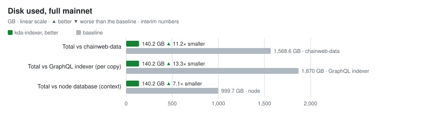

# kda-indexer

An indexer for the [Kadena](https://github.com/kda-community) chainweb blockchain, written in
Rust. It follows a chainweb-node and serves the full history of all 20 chains through a native
API, a chainweb-data compatible REST API (`/txs/*`, `/stats`, `/coins`, plus the kda-txs route
`/v1/txs`) and Kadena's GraphQL schema.

**Status:** validated against chainweb-data and the GraphQL indexer on mainnet; a 72-hour final
validation is in progress; not yet serving production traffic.

## In short

- One binary, installed as a Debian package with a systemd unit next to the node it reads. No
  Postgres, no Docker.
- Mainnet history in <!--m:disk-total-vs-cwd-->140.2 GB<!--/m-->:
  <!--m:disk-total-vs-cwd-->11.2× smaller (−91%)<!--/m--> than chainweb-data on the same host.
- `/txs/account` typical response <!--m:lat-rest-account-p50-->about 16× faster (−94%)<!--/m-->
  and slowest 1% <!--m:lat-rest-account-p99-->about 95× faster (−99%)<!--/m--> than chainweb-data.
- <!--m:corr-unexplained-cg5-->0<!--/m--> unexplained differences from chainweb-data, the
  GraphQL indexer and the node at the end of the CG-5 comparison gate.
- Where it is slower: `/txs/search` slowest 1% is
  <!--m:lat-rest-search-p99-->about 3.6× slower (+260%)<!--/m-->, because patterns that cannot
  use the code index run a bounded scan.

All numbers are interim until the 72-hour validation ends; sources, hardware and caveats are in
[docs/comparison.md](docs/comparison.md).



## Documentation

Start at [docs/README.md](docs/README.md). The main pages:

- [Overview](docs/overview.md): what it indexes and serves, who it is for, what it does not do.
- [Architecture](docs/architecture.md): from the node to the APIs, reorgs, the data directory.
- [Comparison](docs/comparison.md): disk, response time, correctness, sync and memory, as change rates.
- [Methodology](docs/methodology.md): how it was built and checked.
- [Explorer](docs/explorer.md): powering a Kadena explorer with the GraphQL API.
- [Install](docs/install.md) and [operations](docs/operations.md): running it.
- [Native API](docs/api.md), [GraphQL](docs/graphql.md), [on-disk format](docs/format.md): reference.

## Building

```sh
cargo build --release
./target/release/kda-indexer --config packaging/config/mainnet01.toml.example config check
```

The pinned toolchain in `rust-toolchain.toml` is installed automatically by `rustup`. Copy `packaging/config/mainnet01.toml.example` and adjust the node URL and listen addresses for your host.

## Installing

Build a Debian package on the host and install it: [docs/install.md](docs/install.md). The package ships a hardened systemd unit (`kda-indexer-<network>`, binary and config under `/opt/coins/kda-indexer/<network>/`, data under `/opt/coins/data/kadena/kda-indexer/<network>/`), a config with loopback listeners and the licence notices.

Operating notes (systemd, the data-dir lock, moving a data dir, read-only `serve`, metrics and alerts, recovering a halted chain): [docs/operations.md](docs/operations.md).

## License

Licensed under either of

- Apache License, Version 2.0 ([LICENSE-APACHE](LICENSE-APACHE))
- MIT license ([LICENSE-MIT](LICENSE-MIT))

at your option.

Unless you explicitly state otherwise, any contribution intentionally submitted for inclusion in this work, as defined in the Apache-2.0 license, shall be dual licensed as above, without any additional terms or conditions.
