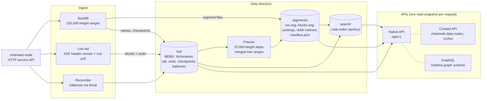

# Architecture

kda-indexer reads blocks from a chainweb-node over HTTP, keeps the recent, still-changing tail
in an MDBX store, and moves finalised history into immutable, compressed segment files with
their own indexes. The APIs read one consistent snapshot of both for every request.

## Data flow



The compat and GraphQL layers use the same read layer as the native API (dotted lines).

## Ingest

Ingest uses the node's HTTP API only; it never opens the node's database files.

- **Backfill** writes history in ranges of 100,000 heights across all chains. Up to
  `backfill.ranges_in_flight` ranges are fetched and decoded at once; they commit in height
  order, so transaction numbers stay dense. Payloads are batch-fetched (`ingest.batch_size`,
  default 50) through a bounded pool (`ingest.node_concurrency`, default 8) with a request
  rate cap (`ingest.max_rps`), so a serving node is not overrun. Each range is spooled to
  `etl/`, then written as segment files in one sequential pass.
- **The live tail** starts at the frozen frontier. Per chain it follows the node's header
  stream, with a `/cut` poll every 10 s to catch missed events, fetches each payload, decodes
  it and applies it to the hot store with an undo record. One writer commits once per
  `tail.commit_ms` (1,000 ms) or `tail.commit_blocks` (40), whichever comes first.
- **Checks on ingest**: parent linkage, payload hash and request keys; the payload Merkle roots
  are recomputed from the leaves the node served and the block is marked verified when they
  match.
- **The reconciler** reads balances and guards from the node's `/local` for accounts that new
  blocks touched, rate-limited (`balances.local_rps`). Pact is executed by the node, not by
  kda-indexer.
- **The search stage** adds new distinct `exec` code bodies to the code index every
  `search.commit_secs` (60 s).

Measured backfill rates by height range are in [operations.md](operations.md#measured-mainnet-backfill).

## Hot store and freezer

The hot store (MDBX) holds everything mutable: name dictionaries (accounts, modules, event
names, public keys), the unfinalised tail of every chain, one undo record per tail block,
stage checkpoints and balances.

The freezer moves a 10,000-height **step** out of the hot store once every chain's tip is at
least `ingest.finality_depth` (1,000) above its end. It writes the step's segment files,
updates `manifest.json`, then deletes the step's hot rows, in that order; a crash in between
is repaired on the next start. Ten steps are later merged into one 100,000-height range with
stronger compression. Segment files are never modified after they are written.

## Segments and indexes

Each range or step is a set of files covering all chains for its heights:

| File | Contents |
|---|---|
| `txs.seg`, `blocks.seg` | Transaction and block records, zstd-compressed with trained dictionaries, with offset files |
| `keys.ef` | First transaction number of every block slot |
| `rk.idx`, `bh.idx` | Request key → transaction, block hash → block |
| `acct`, `xfer`, `pk`, `evt`, `code`, `pact` `.pst` | Posting lists: transactions by account, by transfer (account and token), by signing key, by event name or module, by code body, by pactId |
| `range.toml` | The range header, with a blake3 sum of every other file |

`segments/manifest.json` lists the ranges and steps that are live; files it does not list are
leftovers and are deleted on start. Lookups go newest first: the hot tail, then each range.

The code search index (`search/`) holds one document per distinct `exec` code body, indexed
by 3-character n-grams. It is derived data: `kda-indexer search rebuild` recreates it from
`hot/` and `segments/`.

## Reads

Every API request opens one MDBX read transaction and one snapshot of the segment set.
Heights below the segment frontier come from segments, heights above it from hot rows, so a
transaction is never listed twice or torn across a freeze or merge; it can be briefly missing
while a block is applied. Readers never hold a read transaction longer than one request.

`kda-indexer serve` opens the same data directory read-only, so a replica or a snapshot copy
can answer the APIs while another process writes.

## Reorgs

When a new header's parent is not the stored tip of its chain, the tail asks the node for the
new branch, finds the fork point, and in one MDBX transaction applies the undo records back to
the fork point and then applies the new branch. Readers use snapshot isolation, so no request
sees a half-applied reorg. Orphaned transactions are not kept.

Page cursors carry a fingerprint of the block they point into; a cursor whose block was
reorged away answers `400 cursor invalidated by reorg` instead of pointing at a different
transaction.

A reorg deeper than `ingest.finality_depth`, or one that reaches below the frozen frontier,
halts that chain: the other chains keep running, an ERROR is logged and the halt is exposed in
metrics. Recovery is a manual `unwind` described in [operations.md](operations.md#halted-chains).

## Data directory

```
<data_dir>/
  hot/        MDBX: dictionaries, live tail, undo, checkpoints, balances (mutable)
  segments/   immutable range and step files + manifest.json
  search/     code search index (derived, rebuildable)
  etl/        temporary spool files while a range is built (deleted afterwards)
  LOCK        held by the writing process
```

Segments refer to names by integer ids stored in `hot/`, so `segments/` and `hot/` are copied
together; `kda-indexer snapshot` does that consistently while the service runs.

Size on mainnet (heights 0 to about 7.39M, interim):

| Part | Size |
|---|---|
| Transactions (`txs.seg`) | <!--m:disk-part-txs-seg-->96.09 GB<!--/m--> |
| Blocks (`blocks.seg`) | <!--m:disk-part-blocks-seg-->21.72 GB<!--/m--> |
| Posting lists | <!--m:disk-part-postings-->4.73 GB<!--/m--> |
| Request-key and block-hash indexes | <!--m:disk-part-indexes-->3.1 GB<!--/m--> |
| Offsets, filters, manifests | <!--m:disk-part-seg-other-->0.16 GB<!--/m--> |
| Search index | <!--m:disk-part-search-->11.97 GB<!--/m--> |
| Hot store (MDBX) | <!--m:disk-part-hot-->2.42 GB<!--/m--> |
| **Total** | <!--m:disk-total-vs-cwd-->140.2 GB<!--/m--> |

The byte-level format of every file, the write ordering and the integrity checks
(`segments check --deep`, `verify merkle`) are in [format.md](format.md).

## Crates

| Crate | Role |
|---|---|
| `kda-indexer` | The binary and its commands (`run`, `serve`, `backfill`, `snapshot`, `unwind`, `verify`, `search`, `graphql`, …) |
| `kdx-node` | chainweb-node HTTP client |
| `kdx-ingest` | Header walk, fetch, decode and index pipeline, backfill, tail, reorgs, freezer, reconciler |
| `kdx-decode` | Payload and output decoding into typed records |
| `kdx-hot` | The MDBX hot store |
| `kdx-segment` | Segment files, posting lists and indexes |
| `kdx-search` | The code search index |
| `kdx-api` | Read layer, native and compat APIs, admin listener |
| `kdx-graphql` | GraphQL adapter (Kadena graph schema) |
| `kdx-metrics` | Prometheus registry |
| `kdx-compare` | The comparison harness used for validation (see [methodology.md](methodology.md)) |
