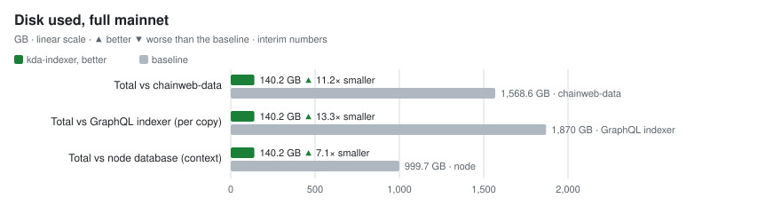
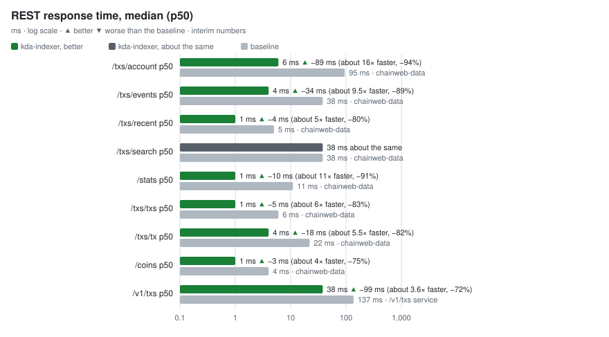
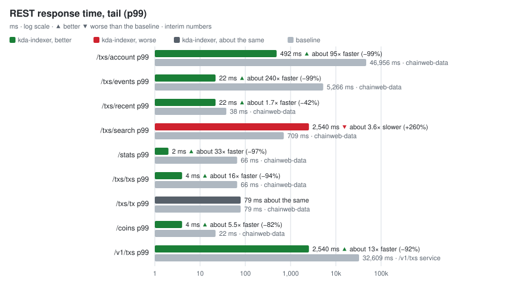
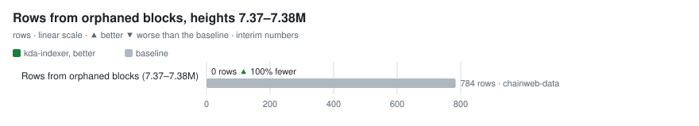

# Comparison with chainweb-data and the GraphQL indexer

kda-indexer stores the mainnet history in about a tenth of chainweb-data's disk, answers most
REST routes several times faster, and matches the node where chainweb-data does not. It is
slower on the slowest `/txs/search` requests. On GraphQL, the account Transactions and Transfers
tabs of an explorer took about 2.5 s on kda-indexer, because of its own `totalCount` walk;
`totalCount` is now exact, as stock's, and its new times are not measured yet. The stock
GraphQL indexer's times are not measured yet. See [explorer.md](explorer.md#speed). Every slower row is listed below with what is known about the reason.

Status: validated against chainweb-data and the GraphQL indexer on mainnet; a 72-hour final
validation is in progress (it ends 2026-11-19 17:05Z); not yet serving production traffic.
**Every number on this page is interim.** The final validation summary and a same-host
benchmark will replace them.

## Headline

| What | kda-indexer | Baseline | Change |
|---|---:|---:|---|
| Disk, full mainnet (interim) | <!--m:disk-total-vs-cwd-->140.2 GB<!--/m--> | <!--m:disk-total-vs-cwd-->1,568.6 GB<!--/m--> chainweb-data | ▲ <!--m:disk-total-vs-cwd-->11.2× smaller (−91%)<!--/m--> |
| `/txs/account` median response (interim) | <!--m:lat-rest-account-p50-->6 ms<!--/m--> | <!--m:lat-rest-account-p50-->95 ms<!--/m--> chainweb-data | ▲ <!--m:lat-rest-account-p50-->−89 ms (about 16× faster, −94%)<!--/m--> |
| `/txs/account` slowest 1% (interim) | <!--m:lat-rest-account-p99-->492 ms<!--/m--> | <!--m:lat-rest-account-p99-->46,956 ms<!--/m--> chainweb-data | ▲ <!--m:lat-rest-account-p99-->−46 s (about 95× faster, −99%)<!--/m--> |
| Unexplained differences at the end of gate CG-5 (interim) | <!--m:corr-unexplained-cg5-->0 records<!--/m--> (last record accepted on node evidence) | – | – |
| `/txs/search` slowest 1% (interim) | <!--m:lat-rest-search-p99-->2,540 ms<!--/m--> | <!--m:lat-rest-search-p99-->709 ms<!--/m--> chainweb-data | ▼ <!--m:lat-rest-search-p99-->+1.8 s (about 3.6× slower, +260%)<!--/m-->, <!--m:lat-rest-search-p99-->user-visible<!--/m--> |
| GraphQL response times (interim) | measured with at least 100 samples per operation: [explorer.md](explorer.md#speed) | stock side pending | – |

> **How to read these numbers**
>
> - **Change** compares kda-indexer with the baseline in the same row. "12× faster" is a
>   ratio of the two values; the percent is the change from the baseline (−90% means
>   kda-indexer takes a tenth of the baseline's time or space). ▲ is better than the
>   baseline, ▼ is worse, = is within 2%.
> - **Response times lead with the absolute time** added (+) or saved (−) per request, because
>   a ratio alone misleads: 1 ms against 10 ms is "10× slower" but adds 9 ms to a request
>   that, we assume, already spends about 200 ms crossing the internet.
> - **Added time** classes a slower response against an assumed client round trip of about
>   200 ms: *negligible* under 20 ms added; *noticeable* 20–200 ms added; *user-visible* over
>   200 ms added, or a slowest-1% (p99) time over 1.5 s.
> - **p50** is the median request; **p99** is the slowest 1%.
> - Values marked "about" come from latency histograms whose bucket edges are about ±20%
>   apart; their factors and times are rounded to two significant digits.
> - "not measured" means nobody measured it. No value on this page is estimated.

Every value comes from [data/benchmarks.json](data/benchmarks.json), where each one has its
source line (what, how, when, hardware, version). The charts are generated from the same file.

## Disk

All values in this table are interim.

| Compared with | kda-indexer | Baseline | Change |
|---|---:|---:|---|
| chainweb-data (Postgres) | <!--m:disk-total-vs-cwd-->140.2 GB<!--/m--> | <!--m:disk-total-vs-cwd-->1,568.6 GB<!--/m--> | ▲ <!--m:disk-total-vs-cwd-->11.2× smaller (−91%)<!--/m--> |
| GraphQL indexer, per copy | <!--m:disk-total-vs-graphql-->140.2 GB<!--/m--> | <!--m:disk-total-vs-graphql-->1,870 GB<!--/m--> | ▲ <!--m:disk-total-vs-graphql-->13.3× smaller (−93%)<!--/m--> |
| chainweb-node database (context only) | <!--m:disk-total-vs-node-->140.2 GB<!--/m--> | <!--m:disk-total-vs-node-->999.7 GB<!--/m--> | ▲ <!--m:disk-total-vs-node-->7.1× smaller (−86%)<!--/m--> |

kda-indexer's total splits into compressed segments (transactions <!--m:disk-part-txs-seg-->96.09 GB<!--/m-->,
blocks <!--m:disk-part-blocks-seg-->21.72 GB<!--/m-->, posting lists <!--m:disk-part-postings-->4.73 GB<!--/m-->, request-key
and block-hash indexes <!--m:disk-part-indexes-->3.1 GB<!--/m-->, offsets and filters
<!--m:disk-part-seg-other-->0.16 GB<!--/m-->), the search index (<!--m:disk-part-search-->11.97 GB<!--/m-->) and the hot
store (<!--m:disk-part-hot-->2.42 GB<!--/m-->). [architecture.md](architecture.md#data-directory) explains
each part.

- **How measured:** `du -sb` of the data directory on 2026-11-17, kda-indexer build 0b5cb03,
  full mainnet store (20 chains, 139.5M blocks), on the validation host (8 vCPU AMD EPYC,
  24 GiB RAM, virtual block storage) shared with chainweb-node 3.2.1 and chainweb-data.
  chainweb-data: Postgres `pg_database_size` on the same host, same day.
- **Caveats:** the GraphQL indexer figure (about 1.87 TB per copy) comes from its deployment
  spec; we did not measure it. The node database is there for scale only: kda-indexer reads
  from a chainweb-node and does not replace it.

## Response time: REST routes

The chainweb-data compatible routes (`/txs/*`, `/stats`, `/coins`) are compared with
chainweb-data; `/v1/txs` is compared with the existing kda-txs service it replaces.

All values in these tables are interim.

### Median (p50)

| Route | kda-indexer | Baseline | Change |
|---|---:|---:|---|
| `/txs/account` | <!--m:lat-rest-account-p50-->6 ms<!--/m--> | <!--m:lat-rest-account-p50-->95 ms<!--/m--> | ▲ <!--m:lat-rest-account-p50-->−89 ms (about 16× faster, −94%)<!--/m--> |
| `/txs/events` | <!--m:lat-rest-events-p50-->4 ms<!--/m--> | <!--m:lat-rest-events-p50-->38 ms<!--/m--> | ▲ <!--m:lat-rest-events-p50-->−34 ms (about 9.5× faster, −89%)<!--/m--> |
| `/txs/recent` | <!--m:lat-rest-recent-p50-->1 ms<!--/m--> | <!--m:lat-rest-recent-p50-->5 ms<!--/m--> | ▲ <!--m:lat-rest-recent-p50-->−4 ms (about 5× faster, −80%)<!--/m--> |
| `/txs/search` | <!--m:lat-rest-search-p50-->38 ms<!--/m--> | <!--m:lat-rest-search-p50-->38 ms<!--/m--> | = <!--m:lat-rest-search-p50-->about the same<!--/m--> |
| `/stats` | <!--m:lat-rest-stats-p50-->1 ms<!--/m--> | <!--m:lat-rest-stats-p50-->11 ms<!--/m--> | ▲ <!--m:lat-rest-stats-p50-->−10 ms (about 11× faster, −91%)<!--/m--> |
| `/txs/txs` | <!--m:lat-rest-txs-p50-->1 ms<!--/m--> | <!--m:lat-rest-txs-p50-->6 ms<!--/m--> | ▲ <!--m:lat-rest-txs-p50-->−5 ms (about 6× faster, −83%)<!--/m--> |
| `/txs/tx` | <!--m:lat-rest-tx-p50-->4 ms<!--/m--> | <!--m:lat-rest-tx-p50-->22 ms<!--/m--> | ▲ <!--m:lat-rest-tx-p50-->−18 ms (about 5.5× faster, −82%)<!--/m--> |
| `/coins` | <!--m:lat-rest-coins-p50-->1 ms<!--/m--> | <!--m:lat-rest-coins-p50-->4 ms<!--/m--> | ▲ <!--m:lat-rest-coins-p50-->−3 ms (about 4× faster, −75%)<!--/m--> |
| `/v1/txs` (vs kda-txs) | <!--m:lat-rest-v1txs-p50-->38 ms<!--/m--> | <!--m:lat-rest-v1txs-p50-->137 ms<!--/m--> | ▲ <!--m:lat-rest-v1txs-p50-->−99 ms (about 3.6× faster, −72%)<!--/m--> |

### Slowest 1% (p99)

| Route | kda-indexer | Baseline | Change |
|---|---:|---:|---|
| `/txs/account` | <!--m:lat-rest-account-p99-->492 ms<!--/m--> | <!--m:lat-rest-account-p99-->46,956 ms<!--/m--> | ▲ <!--m:lat-rest-account-p99-->−46 s (about 95× faster, −99%)<!--/m--> |
| `/txs/events` | <!--m:lat-rest-events-p99-->22 ms<!--/m--> | <!--m:lat-rest-events-p99-->5,266 ms<!--/m--> | ▲ <!--m:lat-rest-events-p99-->−5.2 s (about 240× faster, −99%)<!--/m--> |
| `/txs/recent` | <!--m:lat-rest-recent-p99-->22 ms<!--/m--> | <!--m:lat-rest-recent-p99-->38 ms<!--/m--> | ▲ <!--m:lat-rest-recent-p99-->−16 ms (about 1.7× faster, −42%)<!--/m--> |
| `/stats` | <!--m:lat-rest-stats-p99-->2 ms<!--/m--> | <!--m:lat-rest-stats-p99-->66 ms<!--/m--> | ▲ <!--m:lat-rest-stats-p99-->−64 ms (about 33× faster, −97%)<!--/m--> |
| `/txs/txs` | <!--m:lat-rest-txs-p99-->4 ms<!--/m--> | <!--m:lat-rest-txs-p99-->66 ms<!--/m--> | ▲ <!--m:lat-rest-txs-p99-->−62 ms (about 16× faster, −94%)<!--/m--> |
| `/txs/tx` | <!--m:lat-rest-tx-p99-->79 ms<!--/m--> | <!--m:lat-rest-tx-p99-->79 ms<!--/m--> | = <!--m:lat-rest-tx-p99-->about the same<!--/m--> |
| `/coins` | <!--m:lat-rest-coins-p99-->4 ms<!--/m--> | <!--m:lat-rest-coins-p99-->22 ms<!--/m--> | ▲ <!--m:lat-rest-coins-p99-->−18 ms (about 5.5× faster, −82%)<!--/m--> |
| `/v1/txs` (vs kda-txs) | <!--m:lat-rest-v1txs-p99-->2,540 ms<!--/m--> | <!--m:lat-rest-v1txs-p99-->32,609 ms<!--/m--> | ▲ <!--m:lat-rest-v1txs-p99-->−30 s (about 13× faster, −92%)<!--/m--> |

### Where REST is slower

| Route | kda-indexer | Baseline | Change | Added time |
|---|---:|---:|---|---|
| `/txs/search` p99 | <!--m:lat-rest-search-p99-->2,540 ms<!--/m--> | <!--m:lat-rest-search-p99-->709 ms<!--/m--> | ▼ <!--m:lat-rest-search-p99-->+1.8 s (about 3.6× slower, +260%)<!--/m--> | <!--m:lat-rest-search-p99-->user-visible<!--/m--> |

- **Why:** search patterns that cannot use the code index run a bounded newest-first scan
  (about 2 s), while chainweb-data answers them from Postgres. The median search is the same
  on both sides.

### How the REST times were measured

- **How measured:** the first 24 hours of the 72-hour final validation (window opened
  2026-11-16 17:05Z, read 2026-11-17 16:55Z). The comparison harness sends the same request
  to kda-indexer and to the baseline and records both latencies. Both run on the validation
  host described under Disk; kda-indexer build 0b5cb03.
- **Caveats:**
  - Values are histogram bucket upper edges (about ±20%).
  - The baseline is read at a paced rate.
  - Requests the baseline failed or timed out on are not in its latency. On `/txs/account`
    that is 338 requests beyond the 2,084 compared pairs; across all REST routes it is 1,071.
    Counting them would make the baseline slower, not faster.
  - `/v1/txs` has a slow tail of its own: accounts with thousands of entries at large page
    limits cost about 0.25–1.2 ms per entry.

## Response time: GraphQL

kda-indexer serves Kadena's GraphQL schema; the baseline is the existing GraphQL indexer.

The earlier GraphQL rows here rested on 7 to 11 samples per query class, too few to decide
anything on, and have been removed. kda-indexer's own times, with at least 100 samples per
operation, are in the table in [explorer.md](explorer.md#speed). The stock GraphQL indexer's side
is pending, so there is no comparison to show yet.

> **The stock GraphQL indexer is out of date.** The instances we compared against stopped
> ingesting in June 2026 at height about 6.95M (a gap above their own backfill limit), so they
> serve a database about five months smaller than kda-indexer's. They are being brought to the
> chain tip. Their times are not like-for-like with kda-indexer's until that is done, and the
> comparison will be measured with the same operations and variables afterwards.

## Correctness

Where kda-indexer and chainweb-data disagree, the node decides. The counts below come from
`count(*)` queries after the first full backfill, except the missing-block figure, which is
approximate (about 423).

All values in this table are interim.

| What | kda-indexer | Baseline | Change |
|---|---:|---:|---|
| User transactions, heights 0–7.39M | <!--m:corr-user-txs-->229,926,073 txs<!--/m--> | <!--m:corr-user-txs-->233,094,876 txs<!--/m--> | = <!--m:corr-user-txs-->about the same (1.4% fewer)<!--/m--> |
| Rows from orphaned blocks, heights 7.37–7.38M | <!--m:corr-orphan-rows-->0 rows<!--/m--> | <!--m:corr-orphan-rows-->784 rows<!--/m--> | ▲ <!--m:corr-orphan-rows-->100% fewer<!--/m--> |
| Canonical blocks missing, heights 7.37–7.38M | <!--m:corr-missing-blocks-->0 blocks<!--/m--> | about <!--m:corr-missing-blocks-->423 blocks<!--/m--> | ▲ <!--m:corr-missing-blocks-->100% fewer<!--/m--> |
| `coinsInCirculation`: digits that differ at the same height | <!--m:corr-coins-digits-->0 digits<!--/m--> | <!--m:corr-coins-digits-->0 digits<!--/m--> | = <!--m:corr-coins-digits-->same<!--/m--> |

- **User transactions:** equal below height 4.4M. Above it chainweb-data holds 0.4–3% more
  rows, and those rows come from orphaned blocks. kda-indexer's count is the canonical one;
  the row is marked "about the same" because the two should be equal.
- **Orphan rows and missing blocks:** in heights 7.37–7.38M chainweb-data holds 200,361 block
  rows for 199,577 chain-heights, and about 423 canonical blocks are absent from it. The node
  confirms kda-indexer's blocks.
- **Unexplained differences:** at the end of comparison gate CG-5 there were
  <!--m:corr-unexplained-cg5-->0 records<!--/m--> unexplained differences between kda-indexer and chainweb-data,
  the GraphQL indexer and the node. The count fell <!--m:proc-cg5-unexplained-round-1-->228<!--/m--> → <!--m:proc-cg5-unexplained-round-2-->90<!--/m--> → <!--m:proc-cg5-unexplained-round-3-->60<!--/m--> → <!--m:proc-cg5-unexplained-round-4-->8<!--/m--> → <!--m:proc-cg5-unexplained-round-5-->1<!--/m--> → <!--m:corr-unexplained-cg5-->0<!--/m--> over the
  re-check rounds, and none of the 228 was caused by kda-indexer. The last record was accepted
  on node evidence (the node's data agreed with kda-indexer), not by a harness rule.
  [methodology.md](methodology.md) explains the rounds.
- **The final validation's own difference count** is not published yet: its records are still
  being triaged, and the count will be published with the final summary.
- **How measured:** exact counts after the first full backfill on 2026-11-10, chainweb-data
  counted with `count(*)` on the same host; `coinsInCirculation` from `/stats` on both sides
  at the same height. CG-5: a 3-hour window (2 h 58 m, counted as full) on 2026-11-15, then re-checks of the
  stored records after each harness fix.

## Sync

All values in this table are interim.

| Height range | kda-indexer | Baseline | Change |
|---|---:|---:|---|
| Full mainnet backfill, wall time | <!--m:sync-backfill-wall-->8.73 h<!--/m--> | <!--m:sync-backfill-wall-->not measured<!--/m--> | – |
| Overall, blocks/s | <!--m:sync-overall-blocks-->4,433 blocks/s<!--/m--> | <!--m:sync-overall-blocks-->not measured<!--/m--> | – |
| Overall, transactions/s | <!--m:sync-overall-txs-->11,751 txs/s<!--/m--> | <!--m:sync-overall-txs-->not measured<!--/m--> | – |
| 0–0.85M, blocks/s | <!--m:sync-band-0-0.85M-blocks-->5,768 blocks/s<!--/m--> | <!--m:sync-band-0-0.85M-blocks-->not measured<!--/m--> | – |
| 0–0.85M, transactions/s | <!--m:sync-band-0-0.85M-txs-->5,870 txs/s<!--/m--> | <!--m:sync-band-0-0.85M-txs-->not measured<!--/m--> | – |
| 0.85–2.0M, blocks/s | <!--m:sync-band-0.85-2.0M-blocks-->6,208 blocks/s<!--/m--> | <!--m:sync-band-0.85-2.0M-blocks-->not measured<!--/m--> | – |
| 0.85–2.0M, transactions/s | <!--m:sync-band-0.85-2.0M-txs-->6,418 txs/s<!--/m--> | <!--m:sync-band-0.85-2.0M-txs-->not measured<!--/m--> | – |
| 2.0–3.4M, blocks/s | <!--m:sync-band-2.0-3.4M-blocks-->5,359 blocks/s<!--/m--> | <!--m:sync-band-2.0-3.4M-blocks-->not measured<!--/m--> | – |
| 2.0–3.4M, transactions/s | <!--m:sync-band-2.0-3.4M-txs-->7,261 txs/s<!--/m--> | <!--m:sync-band-2.0-3.4M-txs-->not measured<!--/m--> | – |
| 3.4–3.7M, blocks/s | <!--m:sync-band-3.4-3.7M-blocks-->4,703 blocks/s<!--/m--> | <!--m:sync-band-3.4-3.7M-blocks-->not measured<!--/m--> | – |
| 3.4–3.7M, transactions/s | <!--m:sync-band-3.4-3.7M-txs-->8,758 txs/s<!--/m--> | <!--m:sync-band-3.4-3.7M-txs-->not measured<!--/m--> | – |
| 3.7–5.3M, blocks/s | <!--m:sync-band-3.7-5.3M-blocks-->3,000 blocks/s<!--/m--> | <!--m:sync-band-3.7-5.3M-blocks-->not measured<!--/m--> | – |
| 3.7–5.3M, transactions/s | <!--m:sync-band-3.7-5.3M-txs-->15,570 txs/s<!--/m--> | <!--m:sync-band-3.7-5.3M-txs-->not measured<!--/m--> | – |
| 5.3–7.39M, blocks/s | <!--m:sync-band-5.3-7.39M-blocks-->4,609 blocks/s<!--/m--> | <!--m:sync-band-5.3-7.39M-blocks-->not measured<!--/m--> | – |
| 5.3–7.39M, transactions/s | <!--m:sync-band-5.3-7.39M-txs-->13,409 txs/s<!--/m--> | <!--m:sync-band-5.3-7.39M-txs-->not measured<!--/m--> | – |

- **How measured:** a full mainnet backfill from an empty store (139,279,460 blocks,
  369,200,367 transactions, heights 0–7.39M) on 2026-11-11 to 2026-11-12, on the validation
  host, reading from the local node with one height range in flight at idle IO priority.
  Build 8813750.
- **Caveats:** the 3.7–5.3M range holds most user transactions, so blocks/s drops there while
  transactions/s peaks. chainweb-data's backfill was not measured, so there is no baseline
  and no change column.

## Resources

All values in this table are interim.

| What | kda-indexer | Baseline | Change |
|---|---:|---:|---|
| Memory while serving and tailing | <!--m:res-tail-mem-->1.17 GB<!--/m--> | <!--m:res-tail-mem-->0.8 GB<!--/m--> | ▼ <!--m:res-tail-mem-->1.5× larger (+46%)<!--/m--> |
| Memory while serving, window peak | <!--m:res-tail-mem-peak-->1.38 GB<!--/m--> | <!--m:res-tail-mem-peak-->not measured<!--/m--> | – |
| Memory peak during the full backfill | <!--m:res-backfill-peak-->9.8 GiB<!--/m--> | <!--m:res-backfill-peak-->not measured<!--/m--> | – |

- **Memory while serving is a regression, and not like for like.** kda-indexer's figure is its
  process heap (`RssAnon`, sampled once a minute during the final validation); chainweb-data's
  is its container (the Haskell service and Postgres) as `docker stats` reports it at the same
  moment. kda-indexer held flat at about 1.16 GB for 20 hours while serving the harness and
  GraphQL. It also maps about 8 GB of segment files as page cache, which the kernel can reclaim.
- **Backfill needs more memory than serving.** The peak (`VmHWM`) came in the dense 3.7–5.3M
  range, at <!--m:res-backfill-peak-->9.8 GiB<!--/m--> on a 24 GiB host; the tail needs far less.
  chainweb-data's backfill memory was not measured.

## Differences from the stock indexers

The comparison accepts a difference only when it is listed here (or in [api.md](api.md) and
[graphql.md](graphql.md)), or when it is a stock fault of a class listed below and the node
shows it for that record. Every other difference is reported. Each entry of
[compare/allowlist.toml](../compare/allowlist.toml) carries the id named in brackets here.
The G4 replay of real traffic (below) met most of these classes again; its
[difference catalogue](#difference-catalogue) links each class it found to its doc.

### Intended differences

- Event text search covers a bounded recent window; chainweb-data scans further back
  (`event-search-window`). Only whole rows stock lists and kda-indexer does not are explained;
  a row only kda-indexer lists, or a field that differs on a row both sides list, is reported.
- A `search=` or `pactid=` answer cut by its scan window or the 1,000-tx pact cap carries
  `X-Search-Truncated` (`search-window`, `pactid-cap`).
- `/txs/search?search=` matches a tx's own code, not the code of a continuation's first step
  (`search-cont-history`).
- Rows of one height have no defined order in `/txs/search` (`search-tie-order`,
  `pactid-tie-order`) or in GraphQL lists (`graphql-r57-height-ties`); a page cut inside one block
  lists the node's order (`graphql-r75-single-block-cut`). On the first page of a block larger
  than the page, stock held other rows than ours in 51 records (G4 class 7, see
  [graphql.md](graphql.md#schema), Row order); the rest of those lists was not compared.
- GraphQL `totalCount` is exact, as stock's, with no cap (the `graphql-totalcount-cap` and
  `graphql-r58-count-lower-bound` rules are retired). A count the 5 s deadline cuts answers
  `COUNT_TIMEOUT` at the field where stock answers a number; that happens only on decoding
  lists with tens of thousands of rows or more that the stored per-key counts do not hold
  (height, depth and row filters; [graphql.md](graphql.md#transactions-events-and-transfers), `totalCount`).
- `Transfer.orderIndex` is the TRANSFER event's index in the transaction
  (`graphql-h8-transfer-order-index`).
- `creationTime` has whole seconds, as the node's command; stock adds a fraction
  (`graphql-h9-creation-time-fraction`).
- JSON texts that hold objects (`payload.data`, results) may order keys differently
  (`graphql-r57-json-object`).
- An account or `/v1/txs` answer at its row limit ends at a different height
  (`ours-limit-edge`).
- A genesis request key stored on several chains answers 404 on `/txs/tx`, as chainweb-data
  does; `/txs/txs` lists every copy (`genesis-multi-chain-tx`).
- A stock-issued cursor or `next` token is refused once at the cutover; the client restarts
  from the first page ([graphql.md](graphql.md#ids-and-cursors),
  [load-balancer.md](load-balancer.md#4-apply-check-roll-back)).
- Stock root fields outside Kadena's schema (`pools`, `dexMetrics`, `tokenPrices`) are not
  served, so introspection answers differ ([graphql.md](graphql.md#schema)).
- `balance(...)` lists fungible balances only; stock also lists marmalade ledger rows at 0
  (R-G4-03, [graphql.md](graphql.md#schema)).
- Zero rows follow stock's two rules: `fungibleAccount` (and the chain account lists, the
  `…ByPublicKey` lists and the native balance routes) lists every row that exists on chain,
  at any balance; `balance(...)` lists rows above 0, plus zero rows a TRANSFER event touched
  ([graphql.md](graphql.md#accounts)).
- GraphQL `last`/`before` pages of `transactions(isCoinbase: true)` and of lists with no
  account, public key, event name or `fungibleName` argument (the height walk, `events(moduleName)` alone too) reach at most
  200,000 txs back from the newest row; past that ours answers `LIMIT` (the message names
  `first/after`), where stock answers. Account, transfer, event-name and public-key lists
  page `last` from their oldest row and have no such limit
  ([graphql.md](graphql.md#transactions-events-and-transfers)).
- chainweb-data answered the `fluxteam` account list (`limit=200000`, no `minheight`) with
  recent rows only, 27 to 32 against ours' 237; ours answers the whole history (R-G4-05). The
  general cause is inferred from this one account ([api.md](api.md#compat-notes)).

### Stock faults the node disproves

Accepted only where the harness reads the node for that record and the node's data shows stock
wrong. Each entry names the function and the read in `node_read`:

- orphan rows: stock lists rows or counts from non-canonical blocks; the node's canonical header
  at the row's chain and height says another block (`orphan-rows-txs`, `oracle-orphan`,
  `oracle-orphan-rows`, `graphql-r58-oracle-orphan-dupes`, `graphql-r97-oracle-chain-dupes`).
  G4 met them in `blocksFromHeight` ([graphql.md](graphql.md#blocks-and-network));
- missing rows: stock lacks rows the node's `/poll` puts in a canonical block
  (`cwd-missing-node`, `cwd-missing-node-coinbase`, `cwd-events-missing-node`,
  `kdatxs-missing-node`, `kdatxs-events-node`, `oracle-gap`, `graphql-r75-h7-unindexed`,
  `graphql-r75-h7-off-chain`, `graphql-h7-window-referee`). G4 met them in `/v1/txs`
  ([api.md](api.md#compat-notes)) and as funded balance rows stock lacks
  ([graphql.md](graphql.md#accounts));
- wrong counts: stock's `totalCount` disagrees with the rows the node holds
  (`graphql-oracle-count-short`, `graphql-r97-oracle-list-over-count`,
  `graphql-r75-oracle-counts-heights`, `graphql-r58-by-key-extra-row`);
- wrong values: stock's field differs from the node's command or output for that request key
  (`graphql-r62-payload-data`, `graphql-r75-exec-payload-data`, `graphql-r75-payload-rollback`,
  `graphql-r75-signer-address`, `graphql-r75-nested-order-index`,
  `graphql-oracle-decimal-zeros`), and signer order (`cmd.signers`: stock lists one
  transaction's signers in another order; the node's command order and ours agree, 1 record,
  read on the node; no allowlist rule covers it, so a repeat shows as unexplained in a compare
  run). The fields are listed in
  [graphql.md](graphql.md#transaction-fields-where-stock-differs-from-the-node); in `/v1/txs`,
  kda-txs also pairs a request key with another transaction's details
  ([api.md](api.md#compat-notes));
- failed transactions: stock keeps the Pact error as produced at execution time (a `callStack`,
  a source position in `info`), while the node serves the stored output. Accepted by owner
  ruling of 2026-11-19, with the node as the reference; the harness does not read the node per
  record for these (`failed-tx-callstack`, `failed-tx-error-info`). Only a `callStack` stock has
  and ours lacks, and an `info` where ours answers the node's `<toplevel>:0`, are accepted;
  ours having a `callStack`, or any other `info` of ours, is reported;
- stale supply: stock's `networkInfo.coinsInCirculation` is lower while the node's tip is above
  stock's own `lastBlockHeight` (suite rule `networkInfo-coins-stale`).

Accepted on node samples taken when the rule was made, not on a per-record read: the signer
`scheme` stock answers as `""` (`graphql-r58-oracle-empty`) and the nonce whose inner quotes
stock strips (`graphql-r60-oracle-strips-quotes`); see
[graphql.md](graphql.md#transaction-fields-where-stock-differs-from-the-node).

Not accepted: entries without a node read are open and their differences are reported
(`cwd-hole-tx-au4cjml8`, `cwd-hole-txs-au4cjml8`, `cwd-hole-events-7392263`,
`kdatxs-gap-cont-d7bf62`, `oracle-event-order`). Open entries, our own defects and known gaps
match nothing.

## G4 real-traffic replay

**Numbers as of 2026-11-25; to be refreshed after the final G4 checks.** The same results as a
standalone page: [g4-comparison.html](g4-comparison.html).

### Method

Real production requests were captured (GraphQL from 16 to 18 November, REST from 14 to 21
November), and each distinct request was replayed exactly as the client sent it to both
sides: kda-indexer and the stock indexer of that route (the Kadena GraphQL indexer,
chainweb-data or kda-txs). The comparison is a paired compare of the full JSON answers: every
field, every row, the status code and the GraphQL `errors` array. It fails closed: an answer
is equal only when the two bodies are equal after the documented normalizations (float
tolerance, decimal text, key order inside JSON texts), so a shorter list shows as missing
rows and a list in another order shows as a difference. The differences were then closed
in four ways: reads on the node (its canonical headers, `/poll` and `/local` reads), written
rulings, set re-checks with one-off scripts that are not in the repository, and, for the 336
`/v1/txs` records of the first run, pattern matching against an earlier triage with no
per-record read. Four differences are not settled (#7, #37, #38, #39); the tables below say
which checks were weak. Requests the stock side could not answer were replayed on ours
alone, and ours' rows were checked on the node. Balances were checked separately: every
account was scanned and its balance rows compared with the node, except the 489 `lago` rows
and the 23 rows with non-ASCII module names, which the node cannot read (#40, #41). The 16
`balance` differences closed as tip races were closed weakly: "ours now equals stock's
value" does not tell a tip race from a stale row of ours that was fixed later.

Weights: "distinct" counts distinct requests; "7 days" counts the real requests they stand
for.

### Coverage by family

| Family | Distinct / 7-day requests | Compared with stock | Checked on node | Not compared |
|---|---:|---|---|---|
| `blocksFromHeight` | 67,965 / 77,853 | all | 63,582 ok, 0 bad | nested lists in 515 records |
| `transaction` | 16,845 / 34,399 | all | – | ~327 run-1 diffs not itemized |
| `transactions` | 5,207 / 45,596 | all; isCoinbase re-run live | – | gasLimit fix not replayed |
| `transfers` | 554 / 619 | all | – | 44 diffs never classified |
| `balance(...)` | 350 / 371 | all, by position | all accounts, except 489 `lago` and 23 non-ASCII rows | – |
| `fungibleAccount` | 353 / 373 | all | all accounts (same exceptions), and the pending records | – |
| `nonFungibleAccount` | 354 / 374 | none (stock crashes) | none | **never** |
| `lastTokenPriceInKda` | 49 / 242 | 15 (34 stock 504) | – | served version not replayed |
| `pactQuery`, `__schema`, `networkInfo` | 34 / 136 | all | tip rule | – |
| `blocksFromDepth`, `completedBlockHeights`, `events` | 7 / 26 | all | – | 5 diffs never classified |
| REST `/v1/txs` | 1,598 / 28,322 | all (48 h by key; the rest by position) | one-side rows (15) | 336 diffs only matched by pattern |
| chainweb-data `/txs/account` | 52 / 69,725 | the pollers that carry the traffic | `fluxteam` 10/10 | ~46 small accounts |
| chainweb-data `/txs/recent` | 1 / 36,720 | stale cache (test instance with hung queries) | – | **rows never compared** |
| chainweb-data `/txs/search` | 22 / 40 | stock hangs | – | **never** |
| chainweb-data stats | 3 / 20 | stock unavailable | – | not in G4 |
| GraphQL subscriptions | not captured | – | – | volume unknown |

### What is and isn't compared

Each request was replayed as sent, so the comparison covers exactly the page the client asked
for, and nothing beyond it.

| Pattern | Where it happens | Real requests (7 days) | Status | What it means |
|---|---|---:|---|---|
| Only page 1 compared | every paged list: `transactions`, `transfers`, `events`, `balance(...)`, account lists | all list traffic | gap | Clients ask for page 2 and later with a stock-issued cursor, which ours cannot read, so a page-2 request cannot be paired. Only 57 such requests were in the corpus, all nested inside `blocksFromHeight`, and ours answered `invalid cursor`. Ours' own paging to the end was never compared with stock's. |
| Block transactions cut at page 1 | nested `blocksFromHeight → transactions` when a block has more transactions than the page | 41,693 | gap | 515 records: 464 never completed and 51 with a different page 1 because of order. The rest of each block's list was never compared. |
| List length vs content | all lists | – | compared | The whole body is compared, so a shorter list shows as missing or extra rows; count and content are checked together. |
| `totalCount` / `hasNextPage` | wherever the query selects them (`balance`, `transactions`) | – | partly | Compared. One rule accepts stock's count when it is below its own row count. Stock's `totalCount: 1` while listing 2 or more rows (580 cases) was closed by hand. |
| Lists compared by position | `balance(...)` edges, `/v1/txs`, nested block transactions | 371 + 28,322 + 41,693 | harness gap | Order differences show as content differences. They were re-matched by key afterwards: `balance` 270 records, and the 48-hour `/v1/txs` set (219 paths). The 336 `/v1/txs` corpus differences (13,196 requests) were closed by pattern. |
| Per-token limit window | kda-txs `/v1/txs` (25 rows per token) | 2,803 (48 h) | checked | Compared inside the window. In one case stock missed 2 new rows and filled its 25 with older ones; the node confirmed ours. |
| Big limits | chainweb-data `/txs/account?limit=200000` (`fluxteam`) | 35,594 | one account | Ours' full history (237 rows) against stock's recent window (27–32 rows); the node confirmed 10 of 10 sampled ours-only rows. Other accounts were not compared this way. |
| "Incomplete" never reported | all per-family tables | – | gap | The harness flags answers that hit a page limit as incomplete, but no G4 table has that column. |
| Ours only, no stock pair | `nonFungibleAccount` (stock crashes), `/txs/search` (stock hangs), `/txs/recent` (stale cache on the test stock, whose refresh queries were hung) | 374 + 40 + 36,720 | not compared | No stock answer and no node check in G4. |
| Changed after the replay | coinbase `gasLimit`, `lastTokenPriceInKda` | 45,584 + 242 | offline only | Fixed after the replay and checked against the stored answers only. |
| Values compared in full | all balances | 1.21 M accounts | full, with exceptions | Every account was scanned against the node. Not checked: the 489 `lago` rows and the 23 non-ASCII rows, which the node cannot read. Still open: the 7 bridge rows. Rows on chain are listed at any balance, as stock (zero-rows fix). The 16 tip races were closed weakly (see Method). |

Planned before G4 closes: a page-walk check (each side walked to its last page with its own
cursors, rows compared as sets plus `totalCount`, one-side rows read on the node), including
the 515 blocks; a set-based compare for `balance` and `/v1/txs` in the harness, with an
incomplete column; a live replay of the fixed families on the release build; node checks of
`nonFungibleAccount`, `/txs/recent` and `/txs/search`.

### Difference catalogue

All 43 classes the G4 replay found. Counts are distinct cases, with the 7-day weight in
brackets where known; "48 h" marks the REST 48-hour lists. Verdicts: **ours** (ours is right,
the node agrees), **stock** (stock was right; ours was fixed), **both** (both acceptable, a
documented difference), **unknown** (not settled yet).

| # | Difference | Count | Verdict | Documented in |
|---:|---|---|---|---|
| 1 | `transactions(isCoinbase: true)` refused by ours | 5,193 (45,584) | stock; fixed | [graphql.md](graphql.md#zelcore-extensions) |
| 2 | malformed request key: ours `BAD_USER_INPUT`, stock `null` | 8,475 (17,443) | stock; fixed | [graphql.md](graphql.md#transactions-events-and-transfers) |
| 3 | coinbase `meta.gasLimit`: stock the number `0`, ours `"0"` | 5,193 (45,584) | both; matched (not replayed live) | [graphql.md](graphql.md#wire-formats-that-follow-the-oracle-r-p5p9-19) |
| 4 | `lastTokenPriceInKda` not served | 49 (242) | stock; fixed (offline check) | [graphql.md](graphql.md#token-price) |
| 5 | isCoinbase: stock `totalCount` 1 while listing 2 or more rows | 580 | ours | [graphql.md](graphql.md#zelcore-extensions) |
| 6 | order of user transactions inside a block on multi-block lists | 273 | both | [graphql.md](graphql.md#schema) (Row order) |
| 7 | nested `Block.transactions` of a paged block: another page 1 on stock; 464 records never completed | 42 + 9 + 464 (exposure 41,693) | unknown (sets not compared yet); order documented | [graphql.md](graphql.md#schema) (Row order), [Blocks and network](graphql.md#blocks-and-network) |
| 8 | stock-issued cursor in nested `transactions(after:)`: ours `invalid cursor` | 57 (70) | both (cutover transient) | [graphql.md](graphql.md#ids-and-cursors) |
| 9 | stock lists orphan blocks in `blocksFromHeight` | 25 + 8 + 27 | ours | [graphql.md](graphql.md#blocks-and-network) |
| 10 | stock crash `base64url.replace is not a function` | 7 | ours | [graphql.md](graphql.md#blocks-and-network) |
| 11 | stock rounds through JS floats (difficulty, balances, gas price) | 25,621 + 705 + 75 + 8 + 17 keys | ours | [graphql.md](graphql.md#scalars) |
| 12 | key order inside JSON texts | inside 11 and 3 | both | [graphql.md](graphql.md#transactions-events-and-transfers) (Text forms) |
| 13 | stock field quirks: nonce quoting, `pactId` null, `transactionId` `"0"`, `goodResult` null, number text | part of ~4,700 + 2,540 | ours | [graphql.md](graphql.md#transaction-fields-where-stock-differs-from-the-node), [api.md](api.md#compat-notes) (decimal text) |
| 14 | `signers.scheme`: stock `""` | part of ~4,700 | ours | [graphql.md](graphql.md#transaction-fields-where-stock-differs-from-the-node) |
| 15 | `cmd.nonce`: stock strips inner quotes | part of ~4,700 | ours | [graphql.md](graphql.md#transaction-fields-where-stock-differs-from-the-node) |
| 16 | `payload.rollback` | 196 | ours | [graphql.md](graphql.md#transaction-fields-where-stock-differs-from-the-node) |
| 17 | exec `payload.data` | 71 | ours | [graphql.md](graphql.md#transaction-fields-where-stock-differs-from-the-node) |
| 18 | `signers[].address`: stock `null`; the node's `addr` equals ours | 51 | ours | [graphql.md](graphql.md#transaction-fields-where-stock-differs-from-the-node) |
| 19 | signer order: stock lists 1, 0; the node's command order is 0, 1 and ours | 1 | ours | [graphql.md](graphql.md#transaction-fields-where-stock-differs-from-the-node) |
| 20 | `crossChainTransfer.creationTime` in whole seconds | 2 | both | [graphql.md](graphql.md#wire-formats-that-follow-the-oracle-r-p5p9-19) |
| 21 | failed tx `badResult`: `callStack` and `info` | 117 | ours (= node, owner ruling) | [graphql.md](graphql.md#transaction-fields-where-stock-differs-from-the-node) |
| 22 | zero-balance rows and missing chain rows | 42 + 16 + 38 + 61 keys + 5 | as stock: `fungibleAccount` lists every on-chain row at any balance; `balance(...)` lists rows above 0 plus zero rows a TRANSFER touched | [graphql.md](graphql.md#accounts) |
| 23 | `balance` edge order | 82 | both | [graphql.md](graphql.md#zelcore-extensions) |
| 24 | stock lacks funded balance rows | 5 + 12 | ours | [graphql.md](graphql.md#accounts) |
| 25 | ours' rows read before the queue drained, now equal to the node | 216 | both (transient) | [graphql.md](graphql.md#accounts) |
| 26 | `lastBlockHeight` +1 and balance tip races | ~30 + 16 | both | [graphql.md](graphql.md#fields-compared-with-the-node-not-an-oracle) |
| 27 | `__schema` differs; stock-only DEX fields | 4 + 1 (15 + 4) | both | [graphql.md](graphql.md#schema) |
| 28 | `networkInfo` `coinsInCirculation` / `totalGasUsedInKda` | 2 | both | [graphql.md](graphql.md#zelcore-extensions) |
| 29 | `pactQuery` answers `NOT_SUPPORTED` | 26 (97) | both | [graphql.md](graphql.md#schema) |
| 30 | `blocksFromHeight` with an inverted range | 1 | ours | [graphql.md](graphql.md#blocks-and-network) |
| 31 | kda-txs pairs a request key with another tx's block, time, code or chain | ~200 | ours (node 24/24) | [api.md](api.md#compat-notes) |
| 32 | kda-txs event order, and its `_id` | ~120 + 3 | ours (node order) | [api.md](api.md#compat-notes) |
| 33 | kda-txs answers 404 after 30 s, ours 504 | 4 | ours | [api.md](api.md#compat-notes) |
| 34 | kda-txs lacks rows the node has | 4 paths (7,242 in 48 h) | ours | [api.md](api.md#compat-notes) |
| 35 | chainweb-data `/txs/account` without `minheight`: for `fluxteam`, stock answered recent rows only (27–32 against ours' 237; the general cause is inferred) | 1 (35,594; 10,175 in 48 h) | ours (node 10/10) | [api.md](api.md#compat-notes) |
| 36 | chainweb-data `/txs/recent`: stale cache, seen on a test instance whose refresh queries were hung | 1 (36,720; 10,182 in 48 h) | ours (fresher) | [api.md](api.md#compat-notes) |
| 37 | `/txs/search`: ours `[]` in about 2 s, stock hangs | 4–22 (40) | unknown | latency: [Where REST is slower](#where-rest-is-slower); content not checked yet |
| 38 | `transfers` differences never classified | 44 (65) | unknown | not classified yet |
| 39 | `blocksFromDepth`, `completedBlockHeights`, `events` differences never classified | 5 | unknown | not classified yet |
| 40 | non-ASCII module rows the node cannot read, and the `free.kDOGE` collision | 23 + 1 | both | [operations.md](operations.md#token-receivers-pass-d3) |
| 41 | `lago.kwUSDC`, `lago.USD2`, `lago.kwBTC` stub rows: no `get-balance` on the node | 489 rows | neither verifiable; excluded (R-G4-02) | [graphql.md](graphql.md#schema), [operations.md](operations.md#token-receivers-pass-d3) |
| 42 | stock lists marmalade ledger rows at 0 in `balance(...)` | 11 keys | both; ours stays fungible-only (R-G4-03) | [graphql.md](graphql.md#schema) |
| 43 | Hyperlane bridge (`kb-*`) balances: 6 rows missing, 1 wrong | 7 rows | stock and node (ours was wrong); fix merged, recheck pending | [operations.md](operations.md#token-receivers-pass-d3) |

Totals: 43 classes. 4 fixed in ours (1–4); 2 open on ours' side (22, and 43 until its recheck
passes); 4 not settled (7, 37, 38, 39); the rest are documented differences where ours
follows the node or both answers are acceptable.

## What is not compared

- **chainweb-data backfill time, CPU and disk IO:** not measured.
- **GraphQL indexer disk and memory:** the disk figure is from its deployment spec; its memory
  was not measured.
- **Same hardware for the GraphQL baseline:** the GraphQL indexer runs on different, remote
  hardware; only kda-indexer and chainweb-data share a host.
- **Cold cache:** the harness reads a warm, running system. The first read of a heavy account
  after a restart is slower than the numbers above.
- **Load:** these are paced reads. A one-hour load test ran inside the final validation; its
  hour is excluded from the latency above, and its results will be published with the final
  summary.
- **A dedicated benchmark** (same queries, same host, same concurrency against kda-indexer and
  chainweb-data) runs after the final validation and will replace the harness numbers in the
  headline.
