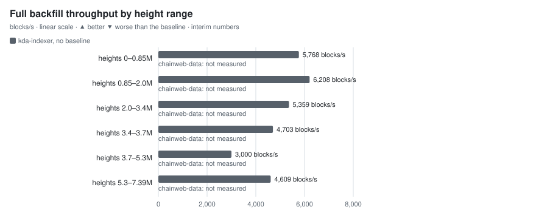

# Comparison with chainweb-data and the GraphQL indexer

kda-indexer stores the mainnet history in about a tenth of chainweb-data's disk, answers most
REST routes several times faster, and matches the node where chainweb-data does not. It is
slower on the slowest `/txs/search` requests. On GraphQL, the account Transactions and Transfers
tabs of an explorer take about 2.5 s on kda-indexer today, and a fix is in progress; the stock
GraphQL indexer's times are not measured yet. See [explorer.md](explorer.md#speed). Every
slower row is listed below with what is known about the reason.

Status: validated against chainweb-data and the GraphQL indexer on mainnet; a 72-hour final
validation is in progress (it ends 2026-11-19 17:05Z); not yet serving production traffic.
**Every number on this page is interim.** The final validation summary and a same-host
benchmark will replace them.

## Headline

| What | kda-indexer | Baseline | Change |
|---|---:|---:|---|
| Disk, full mainnet (interim) | <!--m:disk-total-vs-cwd-->140.2 GB<!--/m--> | <!--m:disk-total-vs-cwd-->1,568.6 GB<!--/m--> chainweb-data | ▲ <!--m:disk-total-vs-cwd-->11.2× smaller (−91%)<!--/m--> |
| `/txs/account` median response (interim) | <!--m:lat-rest-account-p50-->6 ms<!--/m--> | <!--m:lat-rest-account-p50-->95 ms<!--/m--> chainweb-data | ▲ <!--m:lat-rest-account-p50-->−89 ms (about 16× faster, −94%)<!--/m--> |
| `/txs/account` slowest 1% (interim) | <!--m:lat-rest-account-p99-->492 ms<!--/m--> | <!--m:lat-rest-account-p99-->46,956 ms<!--/m--> chainweb-data | ▲ <!--m:lat-rest-account-p99-->−46 s (about 95× faster, −99%)<!--/m--> |
| Unexplained differences at the end of gate CG-5 (interim) | <!--m:corr-unexplained-cg5-->0 records<!--/m--> (last record accepted on node evidence) | – | – |
| `/txs/search` slowest 1% (interim) | <!--m:lat-rest-search-p99-->2,540 ms<!--/m--> | <!--m:lat-rest-search-p99-->709 ms<!--/m--> chainweb-data | ▼ <!--m:lat-rest-search-p99-->+1.8 s (about 3.6× slower, +260%)<!--/m-->, <!--m:lat-rest-search-p99-->user-visible<!--/m--> |
| GraphQL response times (interim) | measured with at least 100 samples per operation: [explorer.md](explorer.md#speed) | stock side pending | – |

> **How to read these numbers**
>
> - **Change** compares kda-indexer with the baseline in the same row. "12× faster" is a
>   ratio of the two values; the percent is the change from the baseline (−90% means
>   kda-indexer takes a tenth of the baseline's time or space). ▲ is better than the
>   baseline, ▼ is worse, = is within 2%.
> - **Response times lead with the absolute time** added (+) or saved (−) per request, because
>   a ratio alone misleads: 1 ms against 10 ms is "10× slower" but adds 9 ms to a request
>   that, we assume, already spends about 200 ms crossing the internet.
> - **Added time** classes a slower response against an assumed client round trip of about
>   200 ms: *negligible* under 20 ms added; *noticeable* 20–200 ms added; *user-visible* over
>   200 ms added, or a slowest-1% (p99) time over 1.5 s.
> - **p50** is the median request; **p99** is the slowest 1%.
> - Values marked "about" come from latency histograms whose bucket edges are about ±20%
>   apart; their factors and times are rounded to two significant digits.
> - "not measured" means nobody measured it. No value on this page is estimated.

Every value comes from [data/benchmarks.json](data/benchmarks.json), where each one has its
source line (what, how, when, hardware, version). The charts are generated from the same file.

## Disk

All values in this table are interim.

| Compared with | kda-indexer | Baseline | Change |
|---|---:|---:|---|
| chainweb-data (Postgres) | <!--m:disk-total-vs-cwd-->140.2 GB<!--/m--> | <!--m:disk-total-vs-cwd-->1,568.6 GB<!--/m--> | ▲ <!--m:disk-total-vs-cwd-->11.2× smaller (−91%)<!--/m--> |
| GraphQL indexer, per copy | <!--m:disk-total-vs-graphql-->140.2 GB<!--/m--> | <!--m:disk-total-vs-graphql-->1,870 GB<!--/m--> | ▲ <!--m:disk-total-vs-graphql-->13.3× smaller (−93%)<!--/m--> |
| chainweb-node database (context only) | <!--m:disk-total-vs-node-->140.2 GB<!--/m--> | <!--m:disk-total-vs-node-->999.7 GB<!--/m--> | ▲ <!--m:disk-total-vs-node-->7.1× smaller (−86%)<!--/m--> |

kda-indexer's total splits into compressed segments (transactions <!--m:disk-part-txs-seg-->96.09 GB<!--/m-->,
blocks <!--m:disk-part-blocks-seg-->21.72 GB<!--/m-->, posting lists <!--m:disk-part-postings-->4.73 GB<!--/m-->, request-key
and block-hash indexes <!--m:disk-part-indexes-->3.1 GB<!--/m-->, offsets and filters
<!--m:disk-part-seg-other-->0.16 GB<!--/m-->), the search index (<!--m:disk-part-search-->11.97 GB<!--/m-->) and the hot
store (<!--m:disk-part-hot-->2.42 GB<!--/m-->). [architecture.md](architecture.md#data-directory) explains
each part.

- **How measured:** `du -sb` of the data directory on 2026-11-17, kda-indexer build 0b5cb03,
  full mainnet store (20 chains, 139.5M blocks), on the validation host (8 vCPU AMD EPYC,
  24 GiB RAM, virtual block storage) shared with chainweb-node 3.2.1 and chainweb-data.
  chainweb-data: Postgres `pg_database_size` on the same host, same day.
- **Caveats:** the GraphQL indexer figure (about 1.87 TB per copy) comes from its deployment
  spec; we did not measure it. The node database is there for scale only: kda-indexer reads
  from a chainweb-node and does not replace it.

## Response time: REST routes

The chainweb-data compatible routes (`/txs/*`, `/stats`, `/coins`) are compared with
chainweb-data; `/v1/txs` is compared with the existing kda-txs service it replaces.

All values in these tables are interim.

### Median (p50)

| Route | kda-indexer | Baseline | Change |
|---|---:|---:|---|
| `/txs/account` | <!--m:lat-rest-account-p50-->6 ms<!--/m--> | <!--m:lat-rest-account-p50-->95 ms<!--/m--> | ▲ <!--m:lat-rest-account-p50-->−89 ms (about 16× faster, −94%)<!--/m--> |
| `/txs/events` | <!--m:lat-rest-events-p50-->4 ms<!--/m--> | <!--m:lat-rest-events-p50-->38 ms<!--/m--> | ▲ <!--m:lat-rest-events-p50-->−34 ms (about 9.5× faster, −89%)<!--/m--> |
| `/txs/recent` | <!--m:lat-rest-recent-p50-->1 ms<!--/m--> | <!--m:lat-rest-recent-p50-->5 ms<!--/m--> | ▲ <!--m:lat-rest-recent-p50-->−4 ms (about 5× faster, −80%)<!--/m--> |
| `/txs/search` | <!--m:lat-rest-search-p50-->38 ms<!--/m--> | <!--m:lat-rest-search-p50-->38 ms<!--/m--> | = <!--m:lat-rest-search-p50-->about the same<!--/m--> |
| `/stats` | <!--m:lat-rest-stats-p50-->1 ms<!--/m--> | <!--m:lat-rest-stats-p50-->11 ms<!--/m--> | ▲ <!--m:lat-rest-stats-p50-->−10 ms (about 11× faster, −91%)<!--/m--> |
| `/txs/txs` | <!--m:lat-rest-txs-p50-->1 ms<!--/m--> | <!--m:lat-rest-txs-p50-->6 ms<!--/m--> | ▲ <!--m:lat-rest-txs-p50-->−5 ms (about 6× faster, −83%)<!--/m--> |
| `/txs/tx` | <!--m:lat-rest-tx-p50-->4 ms<!--/m--> | <!--m:lat-rest-tx-p50-->22 ms<!--/m--> | ▲ <!--m:lat-rest-tx-p50-->−18 ms (about 5.5× faster, −82%)<!--/m--> |
| `/coins` | <!--m:lat-rest-coins-p50-->1 ms<!--/m--> | <!--m:lat-rest-coins-p50-->4 ms<!--/m--> | ▲ <!--m:lat-rest-coins-p50-->−3 ms (about 4× faster, −75%)<!--/m--> |
| `/v1/txs` (vs kda-txs) | <!--m:lat-rest-v1txs-p50-->38 ms<!--/m--> | <!--m:lat-rest-v1txs-p50-->137 ms<!--/m--> | ▲ <!--m:lat-rest-v1txs-p50-->−99 ms (about 3.6× faster, −72%)<!--/m--> |

### Slowest 1% (p99)

| Route | kda-indexer | Baseline | Change |
|---|---:|---:|---|
| `/txs/account` | <!--m:lat-rest-account-p99-->492 ms<!--/m--> | <!--m:lat-rest-account-p99-->46,956 ms<!--/m--> | ▲ <!--m:lat-rest-account-p99-->−46 s (about 95× faster, −99%)<!--/m--> |
| `/txs/events` | <!--m:lat-rest-events-p99-->22 ms<!--/m--> | <!--m:lat-rest-events-p99-->5,266 ms<!--/m--> | ▲ <!--m:lat-rest-events-p99-->−5.2 s (about 240× faster, −99%)<!--/m--> |
| `/txs/recent` | <!--m:lat-rest-recent-p99-->22 ms<!--/m--> | <!--m:lat-rest-recent-p99-->38 ms<!--/m--> | ▲ <!--m:lat-rest-recent-p99-->−16 ms (about 1.7× faster, −42%)<!--/m--> |
| `/stats` | <!--m:lat-rest-stats-p99-->2 ms<!--/m--> | <!--m:lat-rest-stats-p99-->66 ms<!--/m--> | ▲ <!--m:lat-rest-stats-p99-->−64 ms (about 33× faster, −97%)<!--/m--> |
| `/txs/txs` | <!--m:lat-rest-txs-p99-->4 ms<!--/m--> | <!--m:lat-rest-txs-p99-->66 ms<!--/m--> | ▲ <!--m:lat-rest-txs-p99-->−62 ms (about 16× faster, −94%)<!--/m--> |
| `/txs/tx` | <!--m:lat-rest-tx-p99-->79 ms<!--/m--> | <!--m:lat-rest-tx-p99-->79 ms<!--/m--> | = <!--m:lat-rest-tx-p99-->about the same<!--/m--> |
| `/coins` | <!--m:lat-rest-coins-p99-->4 ms<!--/m--> | <!--m:lat-rest-coins-p99-->22 ms<!--/m--> | ▲ <!--m:lat-rest-coins-p99-->−18 ms (about 5.5× faster, −82%)<!--/m--> |
| `/v1/txs` (vs kda-txs) | <!--m:lat-rest-v1txs-p99-->2,540 ms<!--/m--> | <!--m:lat-rest-v1txs-p99-->32,609 ms<!--/m--> | ▲ <!--m:lat-rest-v1txs-p99-->−30 s (about 13× faster, −92%)<!--/m--> |

### Where REST is slower

| Route | kda-indexer | Baseline | Change | Added time |
|---|---:|---:|---|---|
| `/txs/search` p99 | <!--m:lat-rest-search-p99-->2,540 ms<!--/m--> | <!--m:lat-rest-search-p99-->709 ms<!--/m--> | ▼ <!--m:lat-rest-search-p99-->+1.8 s (about 3.6× slower, +260%)<!--/m--> | <!--m:lat-rest-search-p99-->user-visible<!--/m--> |

- **Why:** search patterns that cannot use the code index run a bounded newest-first scan
  (about 2 s), while chainweb-data answers them from Postgres. The median search is the same
  on both sides.

### How the REST times were measured

- **How measured:** the first 24 hours of the 72-hour final validation (window opened
  2026-11-16 17:05Z, read 2026-11-17 16:55Z). The comparison harness sends the same request
  to kda-indexer and to the baseline and records both latencies. Both run on the validation
  host described under Disk; kda-indexer build 0b5cb03.
- **Caveats:**
  - Values are histogram bucket upper edges (about ±20%).
  - The baseline is read at a paced rate.
  - Requests the baseline failed or timed out on are not in its latency. On `/txs/account`
    that is 338 requests beyond the 2,084 compared pairs; across all REST routes it is 1,071.
    Counting them would make the baseline slower, not faster.
  - `/v1/txs` has a slow tail of its own: accounts with thousands of entries at large page
    limits cost about 0.25–1.2 ms per entry.

## Response time: GraphQL

kda-indexer serves Kadena's GraphQL schema; the baseline is the existing GraphQL indexer.

The earlier GraphQL rows here rested on 7 to 11 samples per query class, too few to decide
anything on, and have been removed. kda-indexer's own times, with at least 100 samples per
operation, are in the table in [explorer.md](explorer.md#speed). The stock GraphQL indexer's side
is pending, so there is no comparison to show yet.

> **The stock GraphQL indexer is out of date.** The instances we compared against stopped
> ingesting in June 2026 at height about 6.95M (a gap above their own backfill limit), so they
> serve a database about five months smaller than kda-indexer's. They are being brought to the
> chain tip. Their times are not like-for-like with kda-indexer's until that is done, and the
> comparison will be measured with the same operations and variables afterwards.

## Correctness

Where kda-indexer and chainweb-data disagree, the node decides. The counts below come from
`count(*)` queries after the first full backfill, except the missing-block figure, which is
approximate (about 423).

All values in this table are interim.

| What | kda-indexer | Baseline | Change |
|---|---:|---:|---|
| User transactions, heights 0–7.39M | <!--m:corr-user-txs-->229,926,073 txs<!--/m--> | <!--m:corr-user-txs-->233,094,876 txs<!--/m--> | = <!--m:corr-user-txs-->about the same (1.4% fewer)<!--/m--> |
| Rows from orphaned blocks, heights 7.37–7.38M | <!--m:corr-orphan-rows-->0 rows<!--/m--> | <!--m:corr-orphan-rows-->784 rows<!--/m--> | ▲ <!--m:corr-orphan-rows-->100% fewer<!--/m--> |
| Canonical blocks missing, heights 7.37–7.38M | <!--m:corr-missing-blocks-->0 blocks<!--/m--> | about <!--m:corr-missing-blocks-->423 blocks<!--/m--> | ▲ <!--m:corr-missing-blocks-->100% fewer<!--/m--> |
| `coinsInCirculation`: digits that differ at the same height | <!--m:corr-coins-digits-->0 digits<!--/m--> | <!--m:corr-coins-digits-->0 digits<!--/m--> | = <!--m:corr-coins-digits-->same<!--/m--> |

- **User transactions:** equal below height 4.4M. Above it chainweb-data holds 0.4–3% more
  rows, and those rows come from orphaned blocks. kda-indexer's count is the canonical one;
  the row is marked "about the same" because the two should be equal.
- **Orphan rows and missing blocks:** in heights 7.37–7.38M chainweb-data holds 200,361 block
  rows for 199,577 chain-heights, and about 423 canonical blocks are absent from it. The node
  confirms kda-indexer's blocks.
- **Unexplained differences:** at the end of comparison gate CG-5 there were
  <!--m:corr-unexplained-cg5-->0 records<!--/m--> unexplained differences between kda-indexer and chainweb-data,
  the GraphQL indexer and the node. The count fell <!--m:proc-cg5-unexplained-round-1-->228<!--/m--> → <!--m:proc-cg5-unexplained-round-2-->90<!--/m--> → <!--m:proc-cg5-unexplained-round-3-->60<!--/m--> → <!--m:proc-cg5-unexplained-round-4-->8<!--/m--> → <!--m:proc-cg5-unexplained-round-5-->1<!--/m--> → <!--m:corr-unexplained-cg5-->0<!--/m--> over the
  re-check rounds, and none of the 228 was caused by kda-indexer. The last record was accepted
  on node evidence (the node's data agreed with kda-indexer), not by a harness rule.
  [methodology.md](methodology.md) explains the rounds.
- **The final validation's own difference count** is not published yet: its records are still
  being triaged, and the count will be published with the final summary.
- **How measured:** exact counts after the first full backfill on 2026-11-10, chainweb-data
  counted with `count(*)` on the same host; `coinsInCirculation` from `/stats` on both sides
  at the same height. CG-5: a 3-hour window (2 h 58 m, counted as full) on 2026-11-15, then re-checks of the
  stored records after each harness fix.

## Sync

All values in this table are interim.

| Height range | kda-indexer | Baseline | Change |
|---|---:|---:|---|
| Full mainnet backfill, wall time | <!--m:sync-backfill-wall-->8.73 h<!--/m--> | <!--m:sync-backfill-wall-->not measured<!--/m--> | – |
| Overall, blocks/s | <!--m:sync-overall-blocks-->4,433 blocks/s<!--/m--> | <!--m:sync-overall-blocks-->not measured<!--/m--> | – |
| Overall, transactions/s | <!--m:sync-overall-txs-->11,751 txs/s<!--/m--> | <!--m:sync-overall-txs-->not measured<!--/m--> | – |
| 0–0.85M, blocks/s | <!--m:sync-band-0-0.85M-blocks-->5,768 blocks/s<!--/m--> | <!--m:sync-band-0-0.85M-blocks-->not measured<!--/m--> | – |
| 0–0.85M, transactions/s | <!--m:sync-band-0-0.85M-txs-->5,870 txs/s<!--/m--> | <!--m:sync-band-0-0.85M-txs-->not measured<!--/m--> | – |
| 0.85–2.0M, blocks/s | <!--m:sync-band-0.85-2.0M-blocks-->6,208 blocks/s<!--/m--> | <!--m:sync-band-0.85-2.0M-blocks-->not measured<!--/m--> | – |
| 0.85–2.0M, transactions/s | <!--m:sync-band-0.85-2.0M-txs-->6,418 txs/s<!--/m--> | <!--m:sync-band-0.85-2.0M-txs-->not measured<!--/m--> | – |
| 2.0–3.4M, blocks/s | <!--m:sync-band-2.0-3.4M-blocks-->5,359 blocks/s<!--/m--> | <!--m:sync-band-2.0-3.4M-blocks-->not measured<!--/m--> | – |
| 2.0–3.4M, transactions/s | <!--m:sync-band-2.0-3.4M-txs-->7,261 txs/s<!--/m--> | <!--m:sync-band-2.0-3.4M-txs-->not measured<!--/m--> | – |
| 3.4–3.7M, blocks/s | <!--m:sync-band-3.4-3.7M-blocks-->4,703 blocks/s<!--/m--> | <!--m:sync-band-3.4-3.7M-blocks-->not measured<!--/m--> | – |
| 3.4–3.7M, transactions/s | <!--m:sync-band-3.4-3.7M-txs-->8,758 txs/s<!--/m--> | <!--m:sync-band-3.4-3.7M-txs-->not measured<!--/m--> | – |
| 3.7–5.3M, blocks/s | <!--m:sync-band-3.7-5.3M-blocks-->3,000 blocks/s<!--/m--> | <!--m:sync-band-3.7-5.3M-blocks-->not measured<!--/m--> | – |
| 3.7–5.3M, transactions/s | <!--m:sync-band-3.7-5.3M-txs-->15,570 txs/s<!--/m--> | <!--m:sync-band-3.7-5.3M-txs-->not measured<!--/m--> | – |
| 5.3–7.39M, blocks/s | <!--m:sync-band-5.3-7.39M-blocks-->4,609 blocks/s<!--/m--> | <!--m:sync-band-5.3-7.39M-blocks-->not measured<!--/m--> | – |
| 5.3–7.39M, transactions/s | <!--m:sync-band-5.3-7.39M-txs-->13,409 txs/s<!--/m--> | <!--m:sync-band-5.3-7.39M-txs-->not measured<!--/m--> | – |

- **How measured:** a full mainnet backfill from an empty store (139,279,460 blocks,
  369,200,367 transactions, heights 0–7.39M) on 2026-11-11 to 2026-11-12, on the validation
  host, reading from the local node with one height range in flight at idle IO priority.
  Build 8813750.
- **Caveats:** the 3.7–5.3M range holds most user transactions, so blocks/s drops there while
  transactions/s peaks. chainweb-data's backfill was not measured, so there is no baseline
  and no change column.

## Resources

All values in this table are interim.

| What | kda-indexer | Baseline | Change |
|---|---:|---:|---|
| Memory while serving and tailing | <!--m:res-tail-mem-->1.17 GB<!--/m--> | <!--m:res-tail-mem-->0.8 GB<!--/m--> | ▼ <!--m:res-tail-mem-->1.5× larger (+46%)<!--/m--> |
| Memory while serving, window peak | <!--m:res-tail-mem-peak-->1.38 GB<!--/m--> | <!--m:res-tail-mem-peak-->not measured<!--/m--> | – |
| Memory peak during the full backfill | <!--m:res-backfill-peak-->9.8 GiB<!--/m--> | <!--m:res-backfill-peak-->not measured<!--/m--> | – |

- **Memory while serving is a regression, and not like for like.** kda-indexer's figure is its
  process heap (`RssAnon`, sampled once a minute during the final validation); chainweb-data's
  is its container (the Haskell service and Postgres) as `docker stats` reports it at the same
  moment. kda-indexer held flat at about 1.16 GB for 20 hours while serving the harness and
  GraphQL. It also maps about 8 GB of segment files as page cache, which the kernel can reclaim.
- **Backfill needs more memory than serving.** The peak (`VmHWM`) came in the dense 3.7–5.3M
  range, at <!--m:res-backfill-peak-->9.8 GiB<!--/m--> on a 24 GiB host; the tail needs far less.
  chainweb-data's backfill memory was not measured.

## What is not compared

- **chainweb-data backfill time, CPU and disk IO:** not measured.
- **GraphQL indexer disk and memory:** the disk figure is from its deployment spec; its memory
  was not measured.
- **Same hardware for the GraphQL baseline:** the GraphQL indexer runs on different, remote
  hardware; only kda-indexer and chainweb-data share a host.
- **Cold cache:** the harness reads a warm, running system. The first read of a heavy account
  after a restart is slower than the numbers above.
- **Load:** these are paced reads. A one-hour load test ran inside the final validation; its
  hour is excluded from the latency above, and its results will be published with the final
  summary.
- **A dedicated benchmark** (same queries, same host, same concurrency against kda-indexer and
  chainweb-data) runs after the final validation and will replace the harness numbers in the
  headline.
