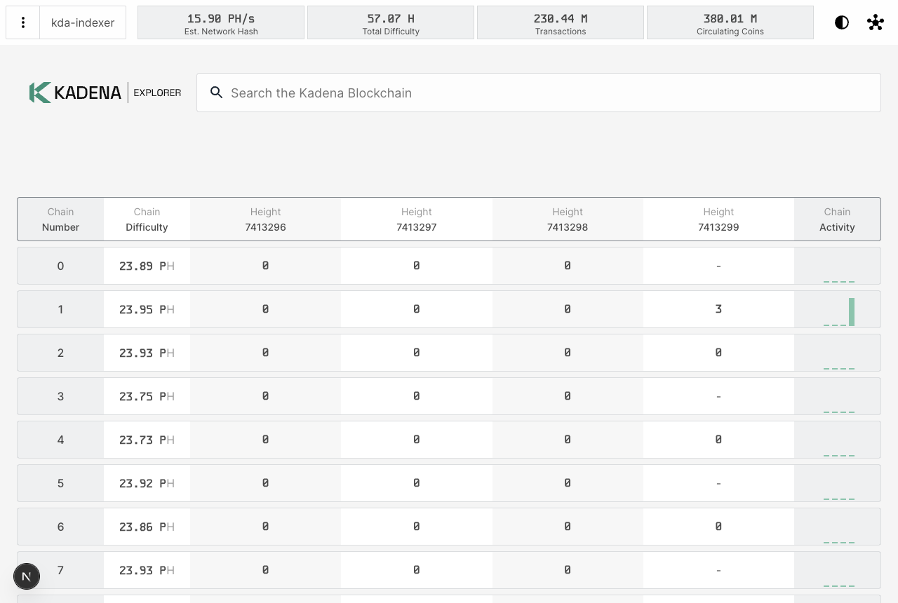
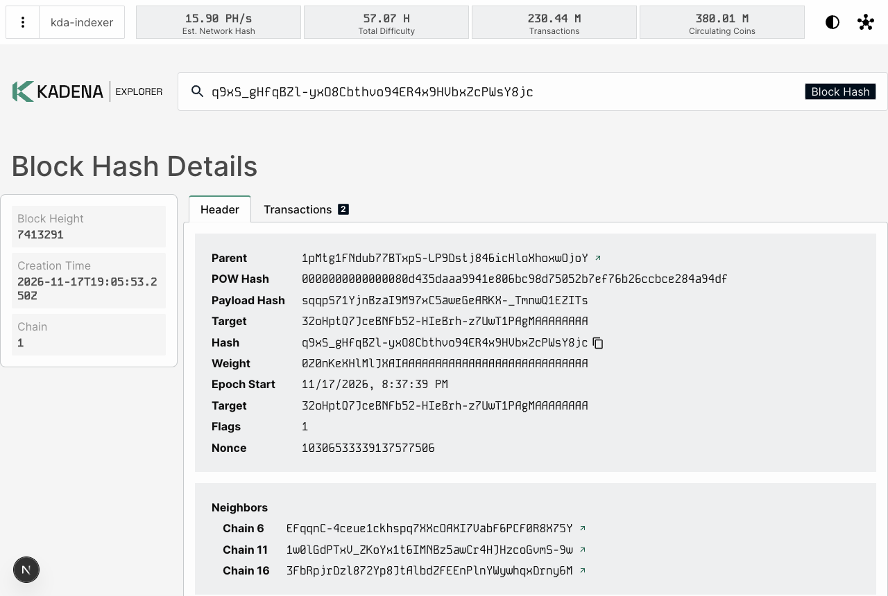
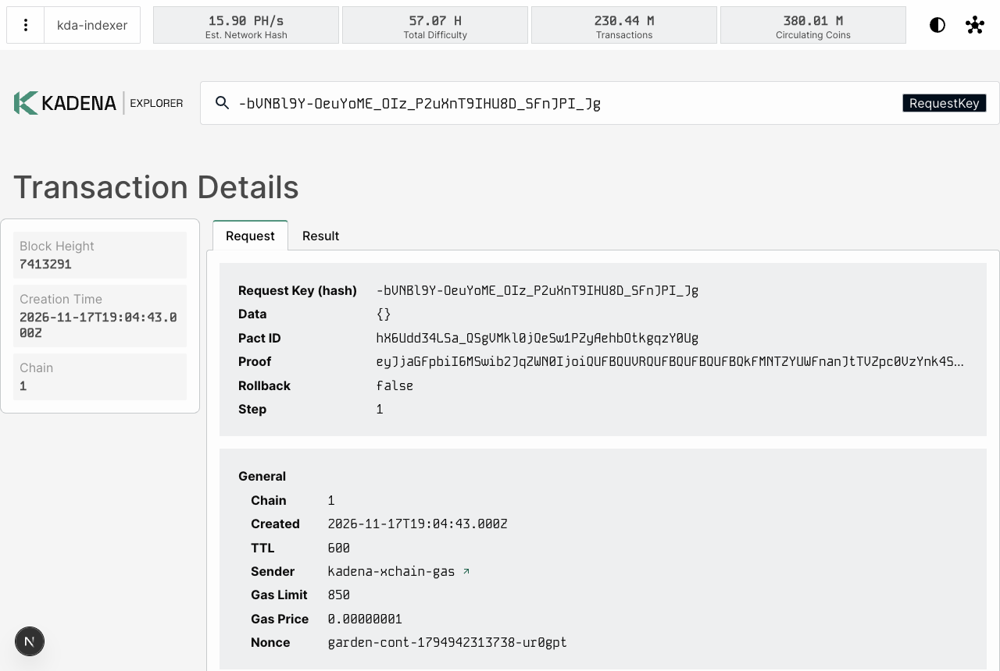
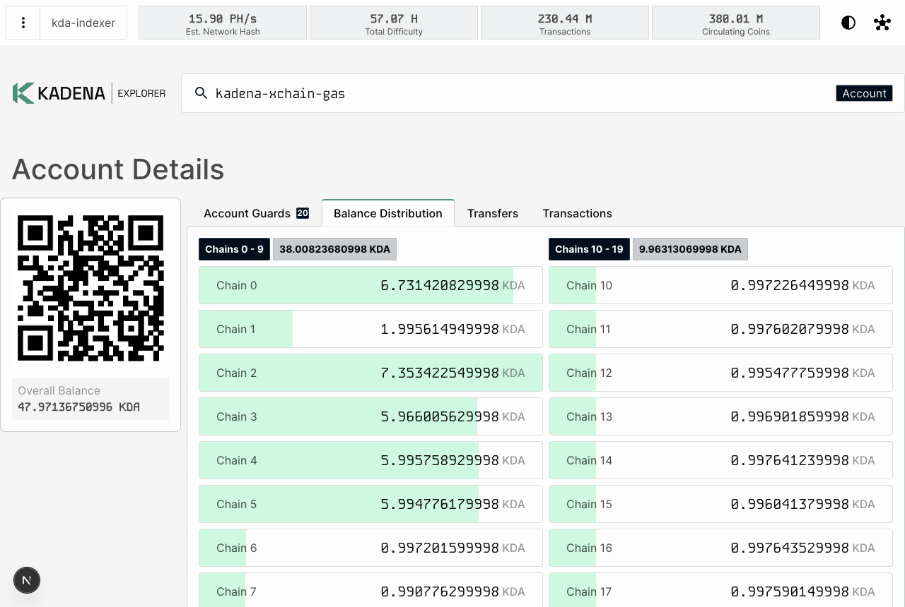

# Power an explorer with kda-indexer

kda-indexer serves Kadena's GraphQL schema, the schema of `@kadena/graph`. An explorer built on
that schema, such as kadscan or the Kadena explorer, can change its GraphQL URL to a kda-indexer
endpoint and keep its own operations, with two documented limits: the default query-cost limit
refuses an events query that spans all 20 chains, and `totalCount` on a long list can answer a
lower bound (slowly today, see [Speed](#speed)). This page gives the evidence for that claim and
lists where the answers differ.

Status: validated against chainweb-data and the GraphQL indexer on mainnet; a 72-hour final
validation is in progress (it ends 2026-11-19 17:05Z); not yet serving production traffic.



## What works, what differs, what is not supported

The schema is Kadena's `generated-schema.graphql`, vendored unchanged. A test compares the two
and pins every addition ([graphql.md](graphql.md#schema)). Type, field and argument names,
defaults, nullability, interfaces and unions are identical.

| | What | Details |
|---|---|---|
| Works | Blocks, block lists, transactions, events, transfers, fungible accounts, `networkInfo`, `node`/`nodes` ids and cursors | Same names, types and id format as Kadena graph. Answers were compared with the GraphQL indexer and the node (see [Same answers](#same-answers)) |
| Works, with one known issue | Non-fungible accounts (`nonFungibleAccount`) | Some early marmalade v1 tokens (ids without the `t:` prefix) are missing from `nonFungibleAccount`. Fixed, not released yet |
| Works | Subscriptions: `newBlocks`, `newBlocksFromDepth`, `events`, `transaction` | Over a websocket on the same `/graphql` path (`graphql-transport-ws` or the older `graphql-ws`). A load test held <!--m:gql-subs-held-->500<!--/m--> live subscriptions with <!--m:gql-subs-duplicates-->0<!--/m--> duplicate and <!--m:gql-subs-misses-->0<!--/m--> missed items, and <!--m:gql-subs-headers-checked-->631<!--/m--> block headers checked against the node |
| Works | The additions kadscan uses: `balance`, `transactionsByPactCode`, `Block.coinbase`, `Block.canonical`, `transactions(isCoinbase)` (coinbases listed as transactions, as stock), `transfers(isNFT)`, the `transactions` subscription and others | Additive only: every Kadena document stays valid ([graphql.md](graphql.md#zelcore-extensions)) |
| Same | Page sizes | 20 items when `first`/`last` is omitted (the schema text says 500), as stock; any page the complexity limit admits is answered in full, up to a 1,000-row safety cap stock does not have |
| Differs | `totalCount` on long lists | Counted up to 10,000 rows within a time budget; a count cut short answers a lower bound and the response carries `"extensions": {"totalCountLowerBound": true}`. Today the budget is up to half of the 5 s request deadline; the fix caps it at 200 ms by default (see [Speed](#speed)) |
| Same | Depth and complexity | Stock's: depth 9 and complexity 4,000 counted as stock counts them, refused with stock's text, code and HTTP status ([graphql.md](graphql.md#limits)) |
| Differs | Other resource limits | 10 operations per batch, a 5 s deadline, 20,000 fields after fragment expansion, 8 directives per field, an introspection cost cap. A refusal is a GraphQL error with `extensions.code = "LIMIT"` |
| Same | Events over all 20 chains | The Kadena explorer builds one `events` field per ticked chain; with all 20 chains ticked it is answered or refused exactly as stock answers or refuses it |
| Differs | `NetworkInfo.countersOfEachChain` | `blocksCount` answers; `transactionCount` and `totalGasUsedInKda` are `null` with `NOT_AVAILABLE` (no all-time per-chain counter is kept) |
| Not supported | `pactQuery`, `gasLimitEstimate` | `NOT_SUPPORTED`: the indexer never runs Pact code for clients. Read contract state from a chainweb-node `/local` instead |
| Not supported | Mempool | `Transaction.result` is never a `TransactionMempoolInfo`; a transaction not yet in a block is `null` |
| Same | `lastTokenPriceInKda` | Stock's price of the newest DEX swap naming the module (`toFixed(12)` text); see [graphql.md](graphql.md#token-price) for the rulings |
| Not supported | `balance` without `accountName` (all holders of a module) | `NOT_SUPPORTED`: no holders index |
| Not supported | Playground, GraphiQL | Not served. Introspection is on |

A field that is not served answers `NOT_SUPPORTED` for that field. The rest of the operation
still answers.

## Evidence: the explorers' own operations

`kda-indexer graphql check-ops DIR` validates every operation document (`*.graphql`, `*.gql`)
in a directory against the served schema and the default limits, without running anything. It
prints `in-scope`, `invalid: …` or `limit: …` for each document. It needs no config and no
store. Variables are not bound, so a page size that only a variable sets is costed at the
largest page (100). That is the worst case.

Two explorers were checked on 2026-11-17 with build 0b5cb03:

| Explorer | Documents | in-scope | limit | invalid |
|---|---:|---:|---:|---:|
| kadscan: the documents its web app sends (its source is not public) | 41 | <!--m:checkops-kadscan-in-scope-->37<!--/m--> | <!--m:checkops-kadscan-limit-->4<!--/m--> | <!--m:checkops-kadscan-invalid-->0<!--/m--> |
| Kadena explorer: `packages/apps/explorer` in kadena.js, commit `35b4c805`. The documents its code generator emits, plus one instance of the per-chain events query it builds at run time | 17 | <!--m:checkops-kexp-in-scope-->15<!--/m--> | <!--m:checkops-kexp-limit-->2<!--/m--> | <!--m:checkops-kexp-invalid-->0<!--/m--> |

No document is invalid: every field and argument these explorers ask for exists with the same
type. The `limit` rows break down as follows:

- **kadscan `Blocks`, `Transaction`, `Transactions` (account tab) and `blockTransactions`**
  are refused only when check-ops costs their page variables at the maximum. When the page sizes
  are set (`first` 10 or 25), `Blocks`, `Transaction` and `Transactions` pass. For three of them
  (`Transaction`, `Transactions`, `blockTransactions`), 100 sets of the variables kadscan really
  sends ran against kadscan's documents without a `LIMIT` refusal (see the speed table below).
- **Kadena explorer, events with all 20 chains ticked:** the explorer builds one query with one
  `events` field per ticked chain. Twenty fields cost about 2,000 and are refused; up to 19 chains
  pass. With no chain ticked, the explorer sends a single `events` query, which passes.
- **Kadena explorer `transactions`:** generated by the explorer's code generator but used by no
  page. It passes with `first` 50.

Three kadscan documents pass check-ops but read a field that answers `NOT_SUPPORTED` or
`NOT_AVAILABLE` at run time: `pactQuery`, the per-chain gas counter and `balance` without an
account. The explorer gets an error for that field, and the rest of the
operation still answers.

The per-operation table, with a note on every row, is in
[data/explorer-ops.md](data/explorer-ops.md). To check your own explorer, put its operation
documents in a directory, one per file, and run:

```sh
kda-indexer graphql check-ops ./ops          # one line per document
kda-indexer graphql check-ops ./ops --json   # the same as JSON
```

An explorer that writes its operations as `gql` template literals needs them extracted to files
first, with each fragment it spreads added to the file once.

## Same answers

Validity is not the same as equal answers. During comparison gate CG-5 (a 3-hour window on
mainnet on 2026-11-15), <!--m:proc-cg5-explorer-ops-->1,160<!--/m--> explorer operations
(18 explorer operation documents) and
<!--m:proc-cg5-graphql-queries-->2,072<!--/m--> GraphQL queries were answered by both
kda-indexer and the GraphQL indexer and compared field by field. Where the two disagreed on
data the node holds, the node was the referee. After the re-check rounds,
<!--m:corr-unexplained-cg5-->0<!--/m--> differences were left unexplained.

One caveat: the stock GraphQL indexer instances used for this comparison stopped ingesting in
June 2026, so they lack about five months of recent data that kda-indexer has. For that data
the node, not the stock indexer, was the reference
([comparison.md](comparison.md#response-time-graphql) has the details).
[methodology.md](methodology.md) describes the harness and [comparison.md](comparison.md) the
rest of the results. The 72-hour final validation runs the
same comparison continuously. Its counts are published when it ends.

## Speed

kda-indexer's response time for the 17 kadscan operations that have recorded variables. Each
operation ran at least 100 times with 100 distinct variable sets. Requests were sent one at a
time over loopback on the validation host (8 vCPU AMD EPYC, 24 GiB RAM, virtual block storage,
shared with chainweb-node and chainweb-data), at most 5 requests/s, with a new connection per
request. Build 0b5cb03, 2026-11-17. All values are interim.

The stock GraphQL indexer's column is **pending**. Its instances stopped ingesting in June 2026
and are being brought to the chain tip, so a timing taken now would measure a smaller database.
It will be measured with the same operations and variables.

| Operation | Explorer page | p50 (interim) | p99 (interim) | Stock GraphQL indexer |
|---|---|---:|---:|---|
| `Block` | block by hash | <!--m:exp-block-f6483b86-p50-->4.6 ms<!--/m--> | <!--m:exp-block-f6483b86-p99-->32.7 ms<!--/m--> | pending |
| `blocksFromHeight` (full header) | block page | <!--m:exp-blocksfromheight-18247276-p50-->12.4 ms<!--/m--> | <!--m:exp-blocksfromheight-18247276-p99-->171.4 ms<!--/m--> | pending |
| `BlocksByHeight` | blocks in a height range | <!--m:exp-blocksbyheight-7d3a4973-p50-->11.8 ms<!--/m--> | <!--m:exp-blocksbyheight-7d3a4973-p99-->110.0 ms<!--/m--> | pending |
| `BlocksFromHeight` (`2b764a6f`) | blocks in a height range | <!--m:exp-blocksfromheight-2b764a6f-p50-->2.8 ms<!--/m--> | <!--m:exp-blocksfromheight-2b764a6f-p99-->5.1 ms<!--/m--> | pending |
| `BlocksFromHeight` (`c137684a`) | block heights per chain | <!--m:exp-blocksfromheight-c137684a-p50-->1.4 ms<!--/m--> | <!--m:exp-blocksfromheight-c137684a-p99-->4.2 ms<!--/m--> | pending |
| `blockTransactions` | transactions of blocks | <!--m:exp-blocktransactions-d6646ba8-p50-->23.0 ms<!--/m--> | <!--m:exp-blocktransactions-d6646ba8-p99-->195.6 ms<!--/m--> | pending |
| `Transaction` | transaction page | <!--m:exp-transaction-d62bf364-p50-->11.7 ms<!--/m--> | <!--m:exp-transaction-d62bf364-p99-->38.1 ms<!--/m--> | pending |
| `GetRelatedTransaction` | transaction page | <!--m:exp-getrelatedtransaction-4b2a4e83-p50-->13.9 ms<!--/m--> | <!--m:exp-getrelatedtransaction-4b2a4e83-p99-->38.2 ms<!--/m--> | pending |
| `Query` (`63662f60`) | transaction status | <!--m:exp-query-63662f60-p50-->15.8 ms<!--/m--> | <!--m:exp-query-63662f60-p99-->41.1 ms<!--/m--> | pending |
| `Transactions` (`9e58b95d`) | transactions list | <!--m:exp-transactions-9e58b95d-p50-->3.7 ms<!--/m--> | <!--m:exp-transactions-9e58b95d-p99-->41.5 ms<!--/m--> | pending |
| `FungibleAccount` (`57a45a6a`) | account total | <!--m:exp-fungibleaccount-57a45a6a-p50-->2.8 ms<!--/m--> | <!--m:exp-fungibleaccount-57a45a6a-p99-->11.5 ms<!--/m--> | pending |
| `FungibleAccount` (`78665e6d`) | account per chain | <!--m:exp-fungibleaccount-78665e6d-p50-->2.4 ms<!--/m--> | <!--m:exp-fungibleaccount-78665e6d-p99-->8.4 ms<!--/m--> | pending |
| `NonFungibleAccount` | account NFTs | <!--m:exp-nonfungibleaccount-f77b27d1-p50-->1.1 ms<!--/m--> | <!--m:exp-nonfungibleaccount-f77b27d1-p99-->2.9 ms<!--/m--> | pending |
| `Transfers` (`8c8a0f56`) | account transfers, short list | <!--m:exp-transfers-8c8a0f56-p50-->6.1 ms<!--/m--> | <!--m:exp-transfers-8c8a0f56-p99-->188.6 ms<!--/m--> | pending |
| `Transactions` (`bca501b0`) | account page, Transactions tab | ▼ <!--m:exp-transactions-bca501b0-p50-->2,476.9 ms<!--/m--> | ▼ <!--m:exp-transactions-bca501b0-p99-->2,559.7 ms<!--/m--> | pending |
| `Transfers` (`825fa035`) | account page, Transfers tab | ▼ <!--m:exp-transfers-825fa035-p50-->2,474.0 ms<!--/m--> | ▼ <!--m:exp-transfers-825fa035-p99-->2,578.6 ms<!--/m--> | pending |
| `Transfers` (`f3be2db0`) | account page, Transfers tab (fungible or NFT) | ▼ <!--m:exp-transfers-f3be2db0-p50-->2,473.1 ms<!--/m--> | ▼ <!--m:exp-transfers-f3be2db0-p99-->2,560.7 ms<!--/m--> | pending |

Fourteen of the 17 answer in under 25 ms at the median and under 200 ms at p99. A p99 of 100
samples is close to the maximum, so read it as the worst case seen.

**The account Transactions and Transfers tabs are slow (about 2.5 s).** The sample was 100
distinct variable sets per operation (<!--m:exp-variable-sets-->100<!--/m-->), taken from recorded explorer requests,
and every one of these three operations sat near 2.5 s. The page of results
itself takes about <!--m:exp-account-page-ms-->3 ms<!--/m-->. The time goes to `totalCount`.
Profiled on a heavy account and on an ordinary active account, the count took about
<!--m:exp-count-heavy-ms-->2,470 ms<!--/m--> and <!--m:exp-count-active-ms-->2,500 ms<!--/m-->.

Why: the count walks the account's postings and decodes each one until it has 10,000 rows
or has used its time budget. Today that budget is up to half of the 5 s request deadline,
about 2.5 s, and then the answer is a lower bound, flagged with `totalCountLowerBound`. Some
accounts reach the 10,000-row cap first, in well under a second. In this sample,
<!--m:exp-account-timeouts-->3<!--/m--> requests of the account tab's `Transactions` operation
ran out of the whole deadline (`TIMEOUT`).

The fix caps the count at a short budget, 200 ms by default, and returns the same flagged lower
bound, with the same response shape as today. It is fixed, not released yet. The new times will be
published once they are measured.

## Screenshots

The Kadena explorer running locally with its GraphQL URL set to a kda-indexer instance. Source:
kadena.js commit `35b4c805`, run as a development build (`next dev`; the small N badge in the
corner is the framework's development indicator). The instance runs on the validation host
(mainnet, build 0b5cb03) and was reached through a loopback tunnel, at most 5 requests/s.
Captured 2026-11-17. The images are unedited. kadscan's front end is not public, so it was not
run.







## Point your explorer at it

1. **Expose the listener.** GraphQL has its own listener, `api.graphql`, which defaults to
   `127.0.0.1:31363` ([install.md](install.md)). The endpoint is `/graphql` for POST, GET and
   the websocket upgrade. The listener speaks plain HTTP. Put TLS in front of it with your load
   balancer and give it its own backend there ([load-balancer.md](load-balancer.md#7-graphql)).
2. **Set the URL in the explorer.** Set both the HTTP URL and the websocket URL to
   `https://<your-host>/graphql` (or `wss://…` where the explorer asks for a websocket scheme).
   In the Kadena explorer, add a network in its network settings with that GraphQL URL. kadscan
   and other explorers have their own setting.
3. **CORS.** Every origin is allowed, so a browser front end on any domain can call the
   endpoint directly.
4. **Limits.** Rate limits and caps are per client IP. Browsers call from their own addresses.
   If the explorer's own server makes the calls, or a proxy sits in front of the indexer, list
   that proxy in `trusted_proxies` so the indexer reads the client address from
   `X-Forwarded-For` ([load-balancer.md](load-balancer.md#client-ips-x-forwarded-for)).
   Otherwise every visitor shares one budget (`api.rate_per_ip`). The query limits are in
   `[graphql]` ([graphql.md](graphql.md#limits)). Depth and complexity are the stock
   indexer's: a document refused here is refused by stock too. Check one with `check-ops`.
5. **Subscriptions.** A websocket on the same path, with protocol `graphql-transport-ws` or
   `graphql-ws`. The balancer needs a tunnel timeout long enough for a page left open (for
   example one hour). The default caps allow 10 connections and 40 subscriptions per client IP.
   An open kadscan page holds a handful.
6. **Check it.** `curl -s https://<your-host>/graphql -H 'content-type: application/json' -d
   '{"query":"{ lastBlockHeight networkInfo { networkId } }"}'` should answer the current height
   and `mainnet01`. Then run `check-ops` over the explorer's documents.
