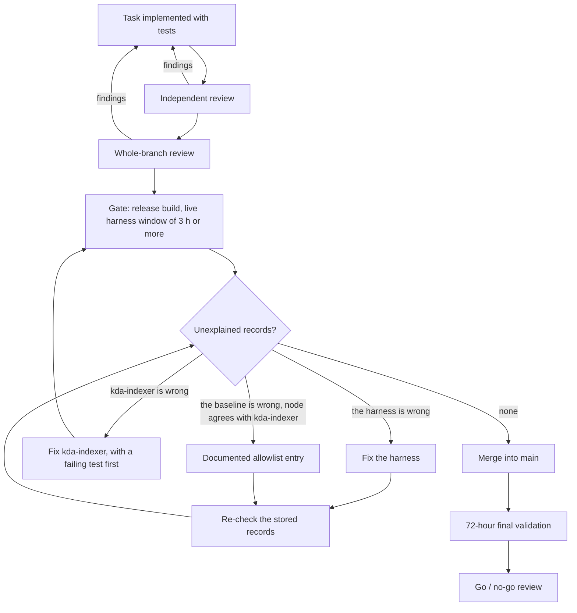

# How kda-indexer was built and checked

kda-indexer was built from a written design in ten phases. Each change was reviewed by someone
other than its author, and its answers were compared request by request with chainweb-data,
the GraphQL indexer and the chainweb-node. Where they disagreed, the node decided, and a
difference counted as explained only when there was evidence for it. This page describes that
process; the resulting numbers are in [comparison.md](comparison.md).

Status: validated against chainweb-data and the GraphQL indexer on mainnet; a 72-hour final
validation is in progress (it ends 2026-11-19 17:05Z); not yet serving production traffic.

## From design to code

The work started with a design document: what to index, the on-disk format, the APIs and their
compatibility rules, the size and speed budgets, and the tests and gates each phase had to pass.
Each phase then had its own plan with numbered tasks. The design and plans are internal working
documents and are not published; the format and API pages in this folder
([format.md](format.md), [api.md](api.md), [graphql.md](graphql.md)) describe the result.

| Phase | What it delivered |
|---|---|
| P0 | Workspace skeleton and format measurements on mainnet data |
| P1 | The comparison harness core (`kda-compare`) |
| P2 | Storage and ingest: hot store, freezer, segments, backfill and tail |
| P3 | The chainweb-data compatible REST API |
| P4 | Debian packaging and the systemd unit |
| P5 | Full mainnet backfill with payload Merkle verification |
| P6 | Search and the remaining REST routes |
| P7 | The GraphQL API on Kadena's schema |
| P8 | Moving traffic: the load-balancer steps and their rollback checks |
| P9 | Hardening: fuzzing, dependency audit, security review, the full test pass |

How each phase was run:

- **Stacked branches.** Each phase lived on its own branch on top of the previous one and was
  merged into `main` with a merge commit once its gate passed.
- **One task, one change, one review.** A task was implemented with its tests, then reviewed
  by a reviewer who had not written it, against the plan (does it do what the task
  says) and for quality (bugs, missing tests, unclear code). Review findings went back as one
  batch per fix round.
- **Tests first for fixes.** A bug fix came with a test that fails without the fix; the fix
  report showed the failing run before the passing one.
- **Whole-branch reviews.** At the end of each phase a reviewer read the whole branch diff, not
  only the last task, looking for problems that sit between tasks.
- **Security review.** The finished stack had a separate security review aimed at what a
  hostile client or a hostile on-chain module could do: GraphQL query cost, slot and
  subscription exhaustion, fake balances from untrusted modules. It reported 1 critical,
  1 high, 7 medium and 5 low findings. The fixes came in two rounds, each with a test that
  fails without it, and were re-reviewed.
- **Checks on every change:** `cargo fmt`, `cargo clippy -D warnings` and the workspace tests;
  `cargo deny` (licences and advisories) on the finished stack. The repository has 11 fuzz
  targets under [fuzz/](../fuzz) for the record, payload and posting-list decoders, the
  manifest, and the request parsers (GraphQL requests, API tokens, forwarded-for headers,
  `LIKE` patterns).

At the release build under final validation (0b5cb03) the Linux test run had
<!--m:proc-tests-passed-->752<!--/m--> passed, <!--m:proc-tests-failed-->0<!--/m--> failed and
<!--m:proc-tests-ignored-->81<!--/m--> ignored. The ignored tests need root, Linux-only paths or a
snapshot store. They were run separately on an earlier validation build (83fc470) with
`--include-ignored` as root on Linux: 731 passed, 0 failed, with one manual store-equality test
skipped (it needs a dev store). The two counts are for different builds and are not comparable.

## Proving the answers are the same: the comparison harness

The harness, `kda-compare` ([crates/kdx-compare](../crates/kdx-compare), configured in
[compare/](../compare)), sends the same request to kda-indexer and to a baseline at the same
moment and compares the two JSON answers field by field.

| kda-indexer surface | Baseline |
|---|---|
| chainweb-data compatible REST (`/txs/*`, `/stats`, `/coins`) | chainweb-data |
| `/v1/txs` | the existing kda-txs service |
| GraphQL | the existing GraphQL indexer |
| blocks, transactions and balances | the chainweb-node, through the `Node*` documents in [compare/graphql](../compare/graphql) |

It is built to fail closed:

- **Every difference is reported** unless an entry in
  [compare/allowlist.toml](../compare/allowlist.toml) matches it. Each entry is narrow (one
  route, a JSON path, a condition such as "only in the baseline") and carries the reason and
  the ruling that accepted it. Examples: chainweb-data returns rows from orphaned blocks that
  kda-indexer does not keep; event text search covers a bounded recent window.
- **Missing evidence is a failure, not a pass.** A timeout, an error on one side, a truncated
  body or a read the referee could not finish leaves the record unexplained.
- **The node referees.** When the two sides disagree on data the node holds (a block, a
  transaction, a balance), the harness reads the node. A difference is explained only when the
  node's data shows which side is right. Where a balance moved between the two reads, the
  harness sums the account's transfer events in the node's blocks in between and requires the
  gap to match exactly.
- **Stored records are re-checked, not re-run.** Every compared pair is stored. When a harness
  rule is fixed, the stored records of the last gate are re-refereed with the new rule instead
  of running a new multi-hour window. Nothing already seen is lost, and a rule change that
  would hide a real difference shows up as a record changing class.
- **Real requests.** Read-only REST requests from production were collected, stripped of client
  addresses and deduplicated, giving <!--m:proc-replay-unique-->2,307<!--/m--> unique requests. They are replayed against the
  baseline and kda-indexer at the same moment, once a day during the final validation. The
  request contents are not published. A GraphQL replay is being prepared the same way.
- **The explorer's own queries.** The GraphQL operation documents of a public Kadena explorer
  are compared as they are, with the variables they really send (see
  [explorer.md](explorer.md)).

### Why a difference is accepted

Every allowlist entry and every rule of the endpoint suite carries an accept class, and an
entry may accept a difference only with positive evidence; without it the record stays open.

| Class | Evidence |
|---|---|
| `stock-wrong-node-evidence` | the node (or stock's own error) shows stock is wrong |
| `stock-self-inconsistent` | stock contradicts itself: its own paging, cursor or count, or a re-fetch |
| `stock-stale` | stock lags or stopped indexing (a configured cut, a late fill) |
| `intended-documented` | a difference these docs state as intended |
| `unsupported-by-design` | a feature the indexer does not offer |
| `tip-timing` | every differing row lies between the two tips the node showed at the two reads |
| `harness-convention` | a comparison convention of the harness, listed below |
| `our-defect` | a known defect of kda-indexer, tracked as a known gap with a rate gate |

The harness compares with these conventions (entries of
[compare/allowlist.toml](../compare/allowlist.toml), each with its reason and ruling):

- `graphql-r57-float`: float and float-valued decimal fields, and numbers above 2^53, compare at
  f64 precision (the reference computes them as JavaScript floats).
- `graphql-r57-json-object`: JSON texts that hold objects compare as objects (key order is no
  difference; numbers keep their text).
- `graphql-r57-field`: a per-field normaliser from the harness config, set after the node referee.
- `graphql-r75-nested-multiset`: a nested list whose rows select no key compares as a multiset
  per parent row.
- `graphql-h6-prefix`: a keyless nested list the reference cut compares as a prefix of ours'
  whole list, under root rows paired by their block.
- `graphql-count-walk`: a differing root `totalCount` is settled by walking both lists to the end.
- `rest-compose`: on one REST record, several row rules combine, each row explained by exactly one.
- `graphql-native-miner-skew`: ours' GraphQL and native balance of a miner, read seconds apart,
  are re-read in the other order when they straddle a block.
- `graphql-r60-scoped-list`: a list bounded by one block or transaction is read to its end on both
  sides when either side cut the page.
- `graphql-coinbase-oracle-key-form` and `graphql-r75-coinbase-request-key`: a coinbase row pairs
  by its place (chain, block, height, index), whatever form of request key each side sends.

## Gates

A phase or fix round could merge only after a comparison gate: the stack head built as a
release, installed on the validation host next to chainweb-node and chainweb-data, and run
under the harness for a window of at least 3 hours. Every unexplained record was then triaged
with the node as referee.

Five gates ran, CG-1 to CG-5. The early ones found real defects in kda-indexer, which were
fixed before merging: for example GraphQL field formats, the request key of coinbase
transactions, the order of block lists and the sender filter of account transactions.

CG-5, the gate for the full stack, compared in its 3-hour window (2 h 58 m, counted as full) on 2026-11-15:

- <!--m:proc-cg5-rest-pairs-->1,503<!--/m--> REST request pairs against chainweb-data and kda-txs on the required routes;
- <!--m:proc-cg5-node-reads-->1,151<!--/m--> block, transaction and balance reads against the node;
- <!--m:proc-cg5-graphql-queries-->2,072<!--/m--> GraphQL queries over 33 operations against the GraphQL indexer;
- <!--m:proc-cg5-explorer-ops-->1,160<!--/m--> explorer operations over 18 documents.

Unexplained records then went <!--m:proc-cg5-unexplained-round-1-->228<!--/m--> → <!--m:proc-cg5-unexplained-round-2-->90<!--/m--> → <!--m:proc-cg5-unexplained-round-3-->60<!--/m--> → <!--m:proc-cg5-unexplained-round-4-->8<!--/m--> → <!--m:proc-cg5-unexplained-round-5-->1<!--/m--> → <!--m:corr-unexplained-cg5-->0<!--/m--> over the re-check rounds. None of
the 228 was a defect in kda-indexer: they were harness rules that were too strict or missing,
timing between reads, and baseline faults (orphan rows, missing blocks) that the node settled.
The last record was accepted on node evidence: the node's data agreed with kda-indexer.

## The 72-hour final validation (in progress)

The release build that `main` now holds (0b5cb03) runs as the installed Debian package on the
validation host from 2026-11-16 17:05Z to 2026-11-19 17:05Z, untouched. Fixes found during the
window go to branches and do not restart it unless the triage says they must.

Before the window, integrity checks over the whole store:

- `segments check --deep`: every file's size and blake3, every record decoded, every request
  key and block hash resolved through the indexes, every posting list walked. 1,184 files,
  139,479,460 blocks, 0 errors.
- `verify merkle --all`: each block's payload Merkle roots recomputed from the stored records
  and compared with the header's. Every era passed.
- `inspect sample --count 10000 --compare-node`: 10,000 frozen and 10,000 hot transactions
  compared with the node, 0 mismatches.

During the window:

- **Comparison:** the harness runs continuously against all four baselines, and the real-request
  replay runs daily. The difference count is published with the final summary, after triage.
- **Leak sampling:** the service's memory is sampled once a minute; a leak is judged on the
  slope over the window, excluding the load-test hour.
- **Freeze-cursor check:** paging cursors handed out before the freezer moves blocks from the
  hot store into segments must continue correctly afterwards. The one freezer step so far
  passed: <!--m:proc-freeze-cursors-->229<!--/m--> cursors followed, each equal to a fresh query.
- **Load test:** one hour of REST at 50 requests/s, explorer GraphQL operations at 20 requests/s
  and 500 websocket subscriptions; error rates, response times, tail lag and memory are
  checked against limits set beforehand. Its hour is excluded from the latency figures.
- **Replica check:** a replica built from a snapshot must serve, then tail the node, with no
  unexplained differences once it is tailing.

After the window, an owner review decides go or no-go on the summary. Regressions in response
time are judged by the absolute time they add (see "How to read these numbers" in
[comparison.md](comparison.md)); a user-visible one is the owner's decision, with its cause and
the size and risk of a fix stated.
